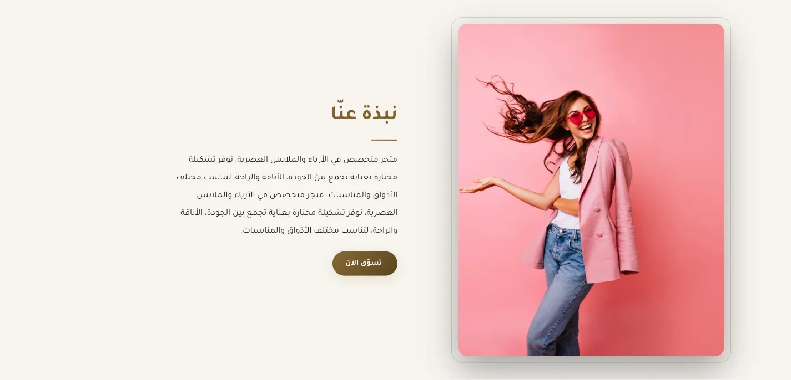
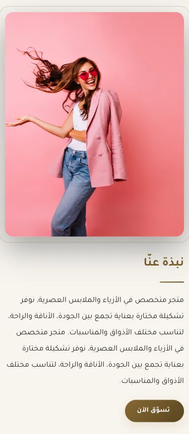
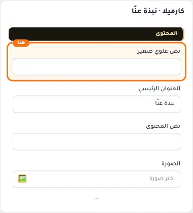
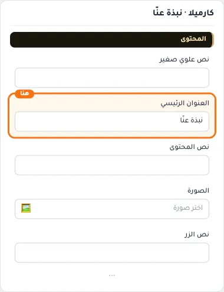
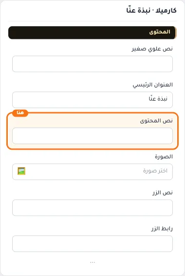
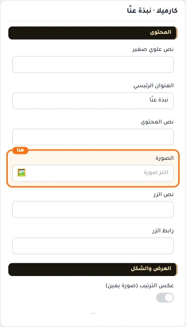
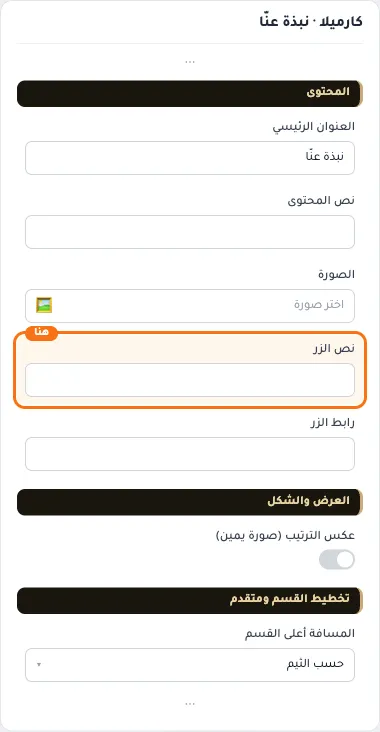
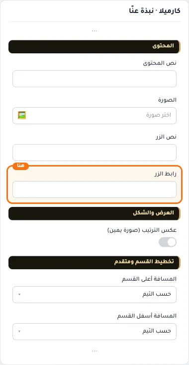
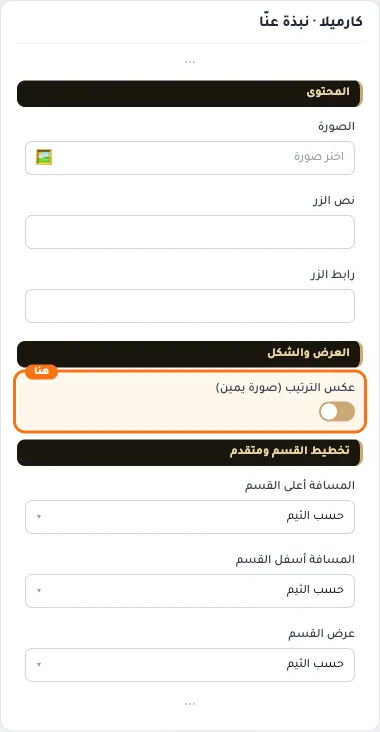
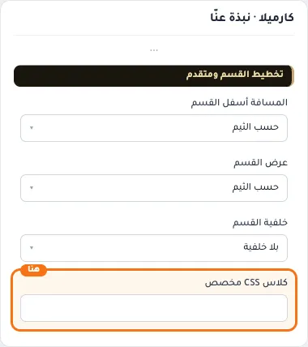

# كارميلا · نبذة عنّا

المسافات والعرض والخلفية والحواف: انظر [الخيارات المشتركة](../../01-shared/README.md).

## «نص علوي صغير»
نص · الافتراضي: فارغ

**الوظيفة:** يظهر فوق العنوان بلون ذهبي

- **نص علوي صغير**
  

## «العنوان الرئيسي»
نص · الافتراضي: نبذة عنّا

**الوظيفة:** العنوان الرئيسي الذي يظهر أعلى القسم. اتركه فارغًا لإخفائه.

- **العنوان الرئيسي**
  

## «نص المحتوى»
نص طويل · الافتراضي: فارغ

**الوظيفة:** النص المعروض في العنصر.

- **نص المحتوى**
  

## «الصورة»
صورة · الافتراضي: فارغ

**الوظيفة:** الحجم المقترح 480×600 بكسل

- **الصورة**
  

## «نص الزر»
نص · الافتراضي: فارغ

**الوظيفة:** اتركه فارغاً لإخفاء الزر

- **نص الزر**
  

## «رابط الزر»
اختيار من المتجر · الافتراضي: فارغ

**الوظيفة:** اختر منتجاً أو تصنيفاً أو صفحة تعريفية أو ماركة... أو الصق رابطاً خارجياً.

- **رابط الزر**
  

## «عكس الترتيب (صورة يمين)»
مفتاح · الافتراضي: مطفأ

**الوظيفة:** يضع الصورة في الجانب الآخر

- **بعد قلب المفتاح**
  

## «كلاس CSS مخصص»
نص · الافتراضي: فارغ

**الوظيفة:** للمصممين. كلاس القسم الثابت: cml-s--cml-about

- **كلاس CSS مخصص**
  
