# كارميلا · بانر سلايدر

المسافات والعرض والخلفية والحواف: انظر [الخيارات المشتركة](../../01-shared/README.md).

## «slides»
عناصر متكررة · الافتراضي: عناصر جاهزة

**الوظيفة:** الشرائح التي يعرضها القسم؛ لكل شريحة صورتها ونصوصها ورابطها.

- **slides**
  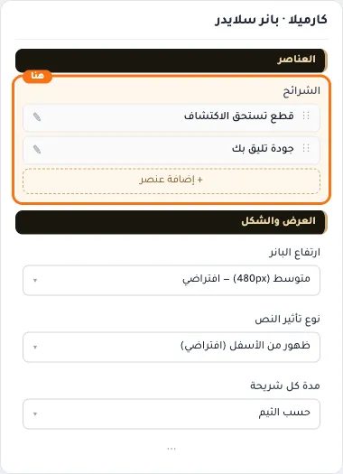

**حقول كل عنصر:**
- «صورة البانر» (صورة، الافتراضي: فارغ): المقاس المقترح 1440×480 (نسبة 3:1)
- «عنوان» (نص، الافتراضي: فارغ): العنوان الرئيسي الذي يظهر أعلى القسم. اتركه فارغًا لإخفائه.
- «نص إضافي» (نص طويل، الافتراضي: فارغ): نص توضيحي يظهر مع العنوان لشرح العرض أو المجموعة.
- «نص زر الإجراء» (نص، الافتراضي: فارغ): النص المكتوب على الزر. اتركه فارغًا لإخفاء الزر.
- «رابط زر الإجراء» (اختيار من المتجر، الافتراضي: فارغ): اختر منتجاً أو تصنيفاً أو صفحة تعريفية أو ماركة... أو الصق رابطاً خارجياً.
- «إزالة طبقة التعتيم» (مفتاح، الافتراضي: مطفأ): يزيل الطبقة الداكنة فوق الصورة؛ مناسب للصور الفاتحة التي تحمل نصًا داكنًا أو بلا نص.
- «موضع النص» (قائمة منسدلة، الافتراضي: وسط): مكان النص فوق الشريحة: يمين أو وسط أو يسار، وأعلى أو أسفل.
- «موضع الصورة» (قائمة منسدلة، الافتراضي: حسب الثيم): الجزء من الصورة الذي يبقى ظاهرًا حين تُقص على الشاشات الضيقة.
- «شكل الزر» (قائمة منسدلة، الافتراضي: ممتلئ): شكل زر الشريحة: ممتلئ أو بإطار.
- «جعل الشريحة كلها رابطاً» (مفتاح، الافتراضي: مطفأ): يجعل الضغط في أي مكان على الشريحة يفتح الرابط، لا الزر وحده.

## «ارتفاع البانر»
قائمة منسدلة · الافتراضي: متوسط (480px) — افتراضي

**الوظيفة:** ارتفاع البانر.

- **صغير (320px)**
  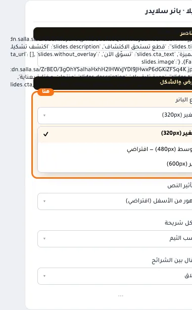
- **متوسط (480px) — افتراضي** — القيمة الافتراضية.
  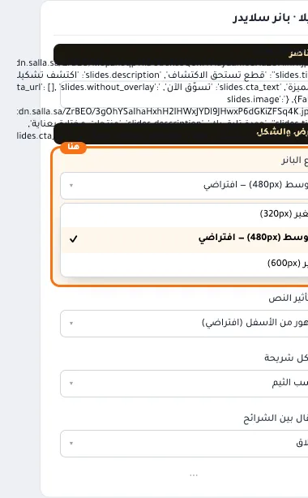
  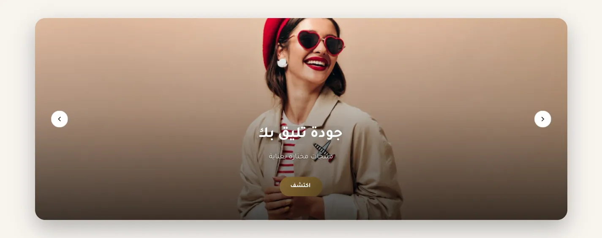
- **كبير (600px)**
  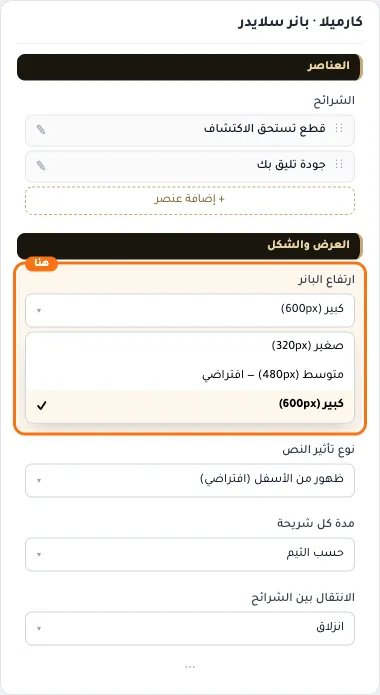

## «نوع تأثير النص»
قائمة منسدلة · الافتراضي: ظهور من الأسفل (افتراضي)

**الوظيفة:** طريقة ظهور النص عند وصول الزائر للقسم.

- **ظهور من الأسفل (افتراضي)** — القيمة الافتراضية.
  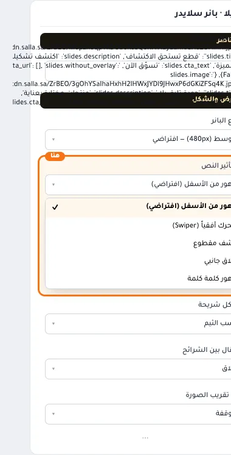
  
- **متحرك أفقياً (Swiper)**
  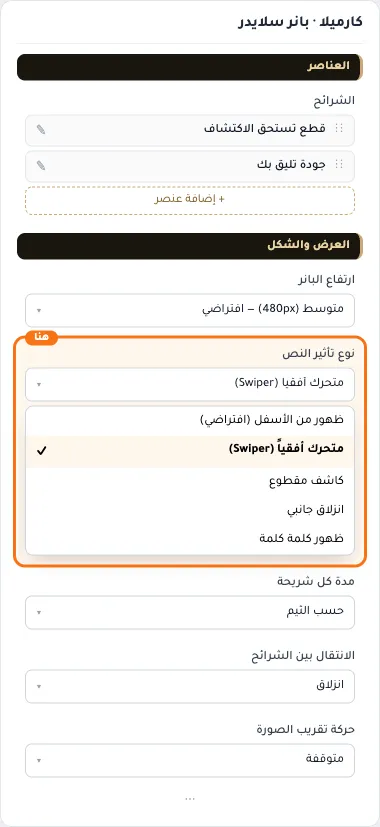
- **كاشف مقطوع**
  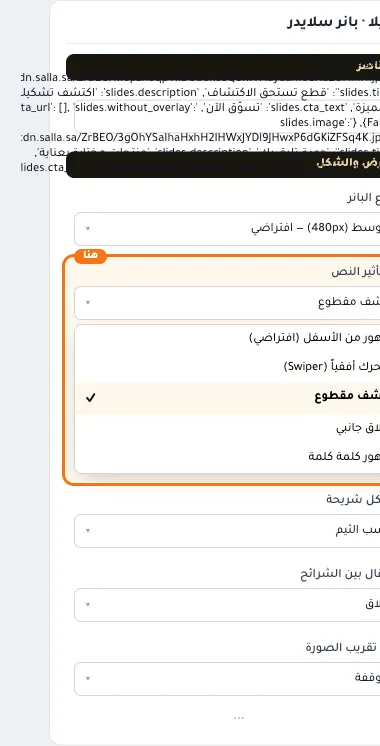
- **انزلاق جانبي**
  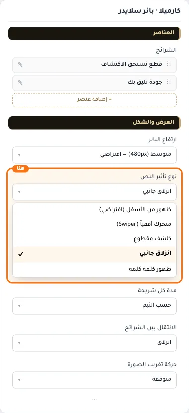
- **ظهور كلمة كلمة**
  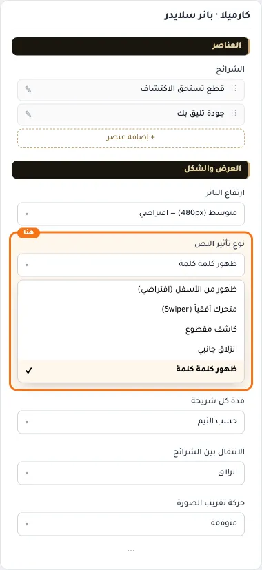

## «مدة كل شريحة»
قائمة منسدلة · الافتراضي: حسب الثيم

**الوظيفة:** كم ثانية تبقى كل شريحة قبل الانتقال للتالية.

- **حسب الثيم** — القيمة الافتراضية.
  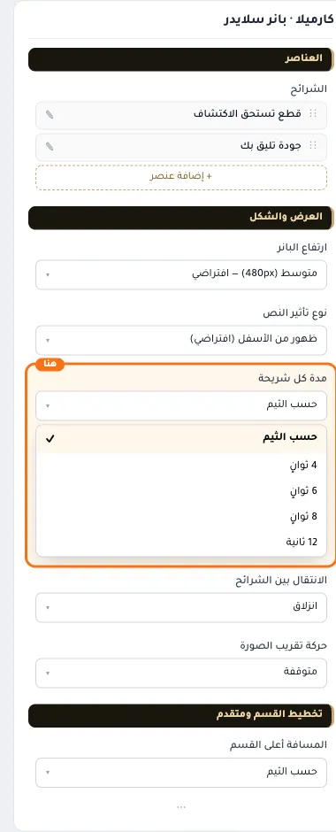
  
- **4 ثوانٍ**
  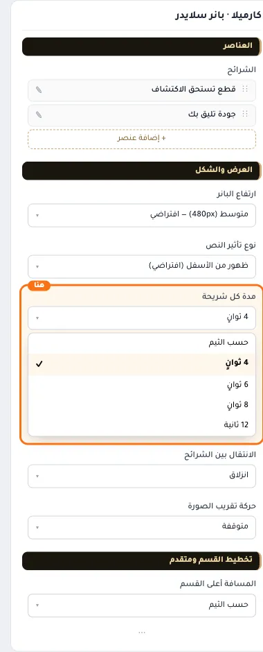
- **6 ثوانٍ**
  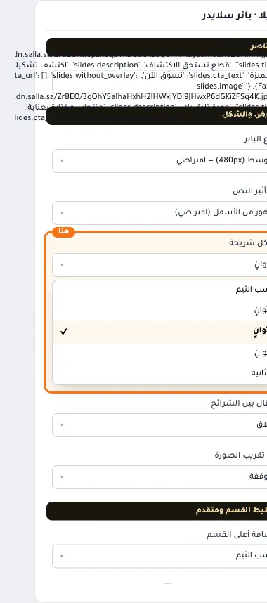
- **8 ثوانٍ**
  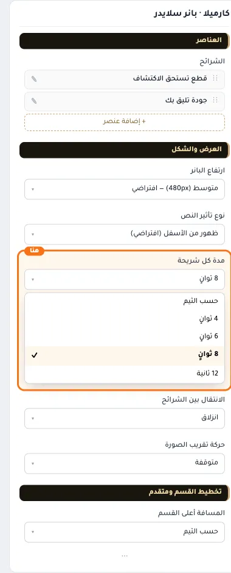
- **12 ثانية**
  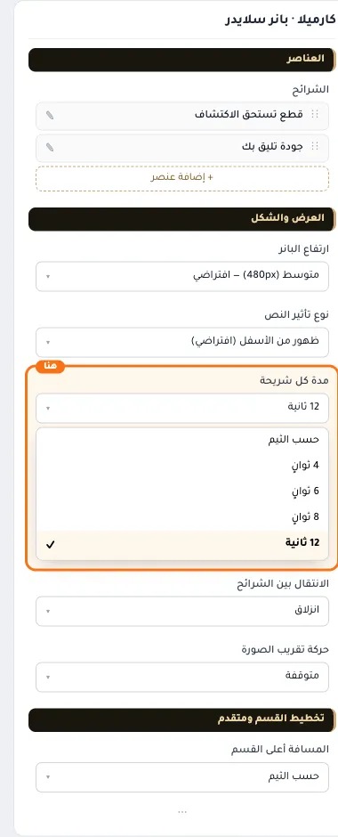

## «الانتقال بين الشرائح»
قائمة منسدلة · الافتراضي: انزلاق

**الوظيفة:** شكل الانتقال بين الشرائح: انزلاق أو تلاشي.

- **انزلاق** — القيمة الافتراضية.
  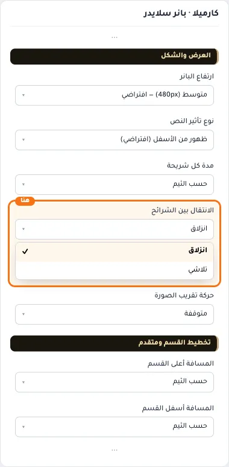
  
- **تلاشي**
  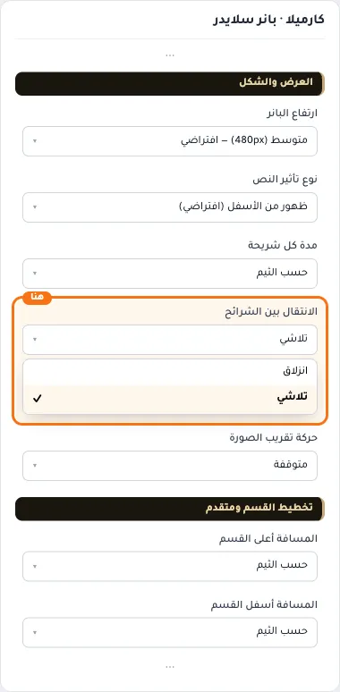

## «حركة تقريب الصورة»
قائمة منسدلة · الافتراضي: متوقفة

**الوظيفة:** تقريب بطيء للصورة أثناء ظهور الشريحة يعطي إحساسًا بالحركة.

- **مفعّلة**
  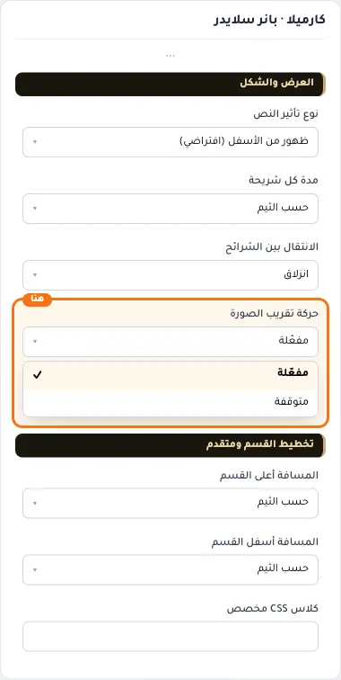
- **متوقفة** — القيمة الافتراضية.
  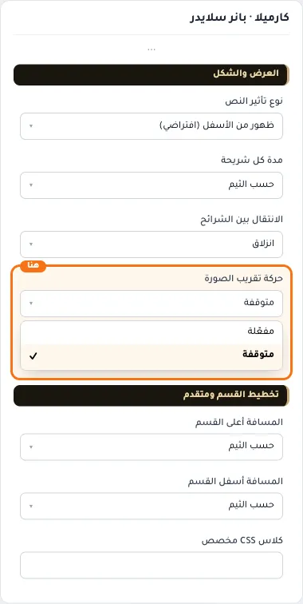
  

## «كلاس CSS مخصص»
نص · الافتراضي: فارغ

**الوظيفة:** للمصممين. كلاس القسم الثابت: cml-s--cml-banner-slider

- **كلاس CSS مخصص**
  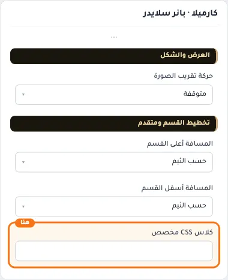
