# كارميلا · أيقونات التواصل الاجتماعي

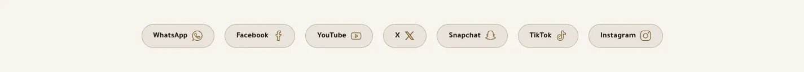

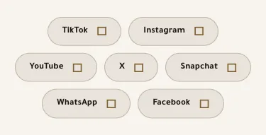

المسافات والعرض والخلفية والحواف: انظر [الخيارات المشتركة](../../01-shared/README.md).

## «عنوان القسم»
نص · الافتراضي: فارغ

**الوظيفة:** العنوان الرئيسي الذي يظهر أعلى القسم. اتركه فارغًا لإخفائه.

- **عنوان القسم**
  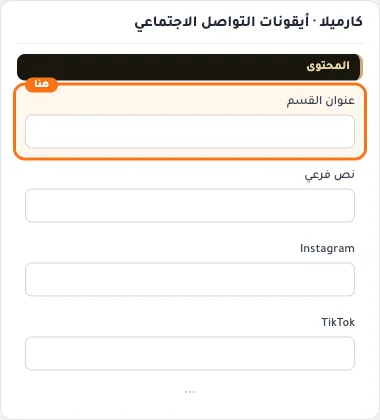

## «نص فرعي»
نص · الافتراضي: فارغ

**الوظيفة:** سطر قصير تحت العنوان يشرح محتوى القسم. اختياري؛ يختفي إن تُرك فارغًا.

- **نص فرعي**
  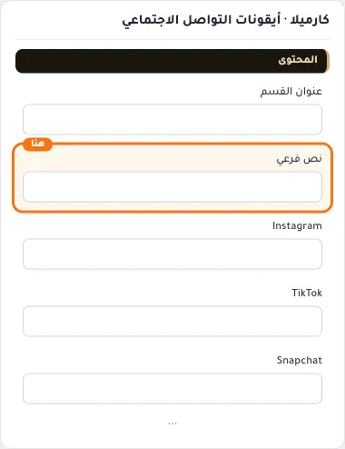

## «Instagram»
نص · الافتراضي: فارغ

**الوظيفة:** اتركه فارغاً لإخفاء الأيقونة

- **Instagram**
  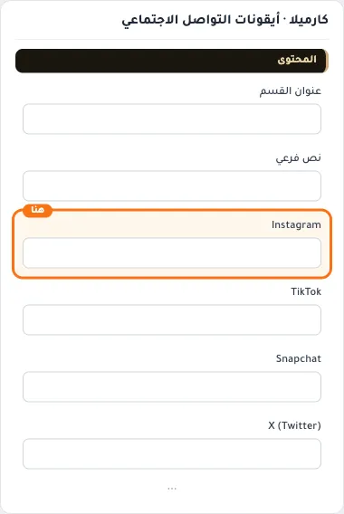

## «TikTok»
نص · الافتراضي: فارغ

**الوظيفة:** اتركه فارغاً لإخفاء الأيقونة

- **TikTok**
  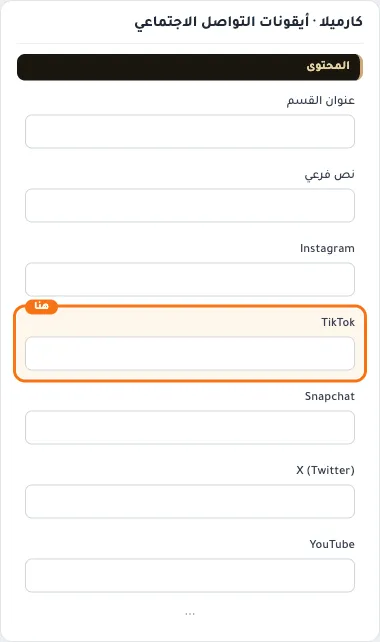

## «Snapchat»
نص · الافتراضي: فارغ

**الوظيفة:** اتركه فارغاً لإخفاء الأيقونة

- **Snapchat**
  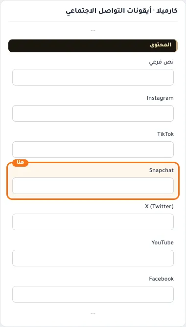

## «X (Twitter)»
نص · الافتراضي: فارغ

**الوظيفة:** اتركه فارغاً لإخفاء الأيقونة

- **X (Twitter)**
  

## «YouTube»
نص · الافتراضي: فارغ

**الوظيفة:** اتركه فارغاً لإخفاء الأيقونة

- **YouTube**
  

## «Facebook»
نص · الافتراضي: فارغ

**الوظيفة:** اتركه فارغاً لإخفاء الأيقونة

- **Facebook**
  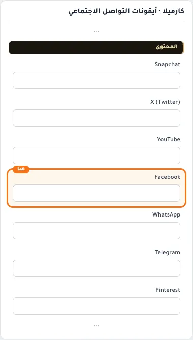

## «WhatsApp»
نص · الافتراضي: فارغ

**الوظيفة:** اتركه فارغاً لإخفاء الأيقونة

- **WhatsApp**
  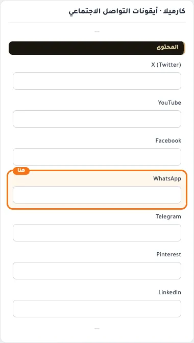

## «Telegram»
نص · الافتراضي: فارغ

**الوظيفة:** اتركه فارغاً لإخفاء الأيقونة

- **Telegram**
  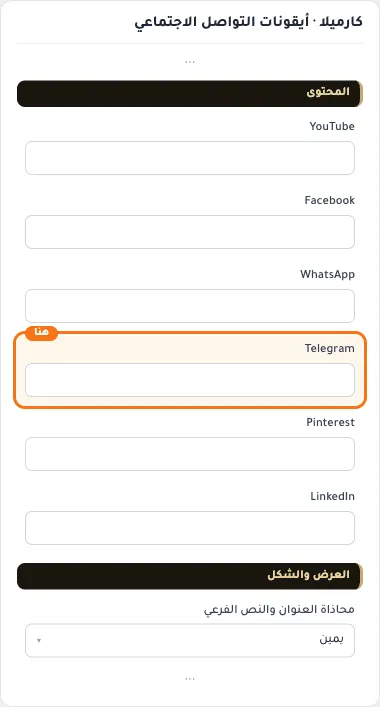

## «Pinterest»
نص · الافتراضي: فارغ

**الوظيفة:** اتركه فارغاً لإخفاء الأيقونة

- **Pinterest**
  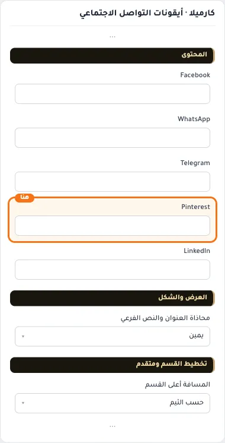

## «LinkedIn»
نص · الافتراضي: فارغ

**الوظيفة:** اتركه فارغاً لإخفاء الأيقونة

- **LinkedIn**
  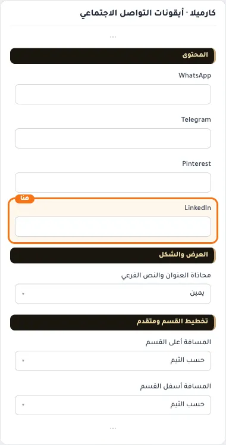

## «محاذاة العنوان والنص الفرعي»
قائمة منسدلة · الافتراضي: يمين

**الوظيفة:** محاذاة العنوان الرئيسي والفرعي داخل القسم (الافتراضي: يمين).

- **يمين** — القيمة الافتراضية.
  
  
- **وسط**
  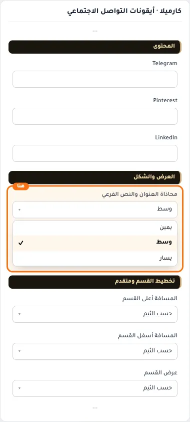
- **يسار**
  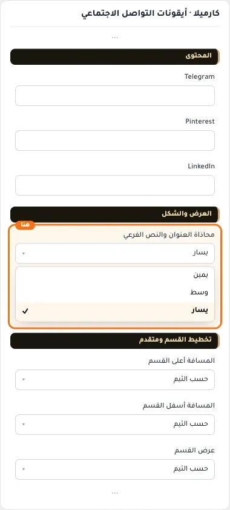

## «كلاس CSS مخصص»
نص · الافتراضي: فارغ

**الوظيفة:** للمصممين. كلاس القسم الثابت: cml-s--cml-social-icons

- **كلاس CSS مخصص**
  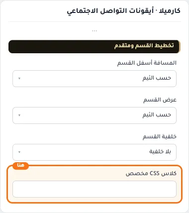
