# كارميلا · مجموعة مختارة مع صورة

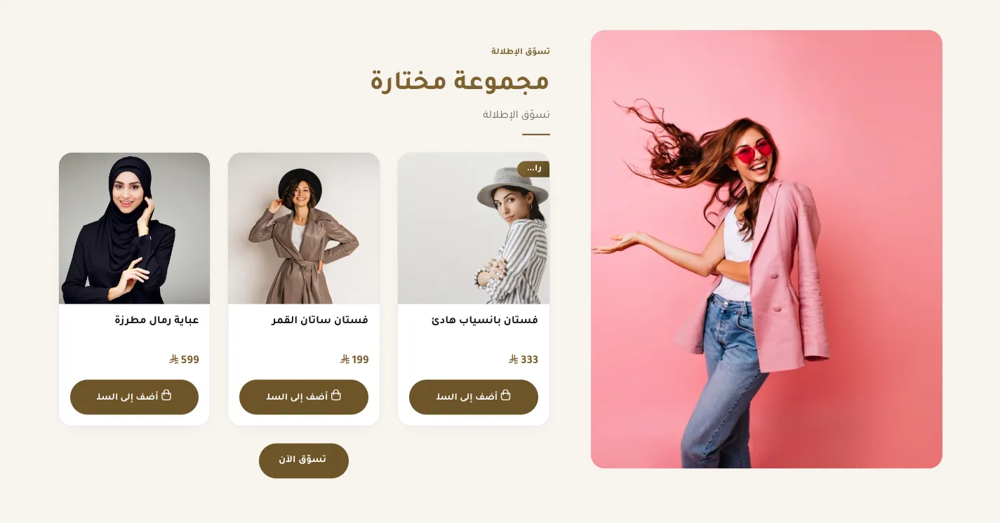

المسافات والعرض والخلفية والحواف: انظر [الخيارات المشتركة](../../01-shared/README.md).

## «عنوان صغير فوق العنوان الرئيسي»
نص · الافتراضي: فارغ

**الوظيفة:** كلمة صغيرة فوق العنوان (مثل «جديد» أو «موسم الصيف») تلفت الانتباه قبل العنوان.

- **عنوان صغير فوق العنوان الرئيسي**
  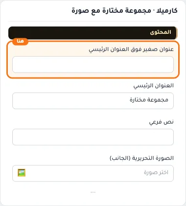

## «العنوان الرئيسي»
نص · الافتراضي: مجموعة مختارة

**الوظيفة:** العنوان الرئيسي الذي يظهر أعلى القسم. اتركه فارغًا لإخفائه.

- **العنوان الرئيسي**
  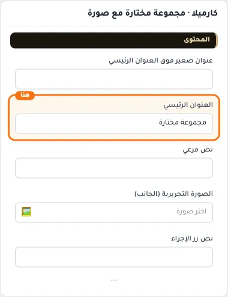

## «نص فرعي»
نص · الافتراضي: فارغ

**الوظيفة:** سطر قصير تحت العنوان يشرح محتوى القسم. اختياري؛ يختفي إن تُرك فارغًا.

- **نص فرعي**
  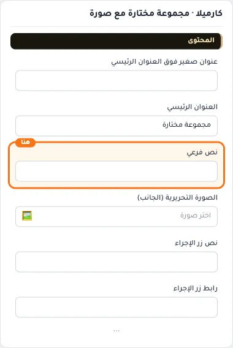

## «الصورة التحريرية (الجانب)»
صورة · الافتراضي: فارغ

**الوظيفة:** مقاس مقترح 600×750 (4:5)

- **الصورة التحريرية (الجانب)**
  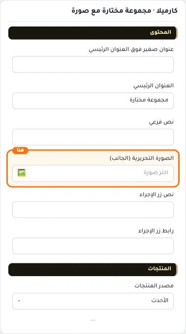

## «نص زر الإجراء»
نص · الافتراضي: فارغ

**الوظيفة:** النص المكتوب على الزر. اتركه فارغًا لإخفاء الزر.

- **نص زر الإجراء**
  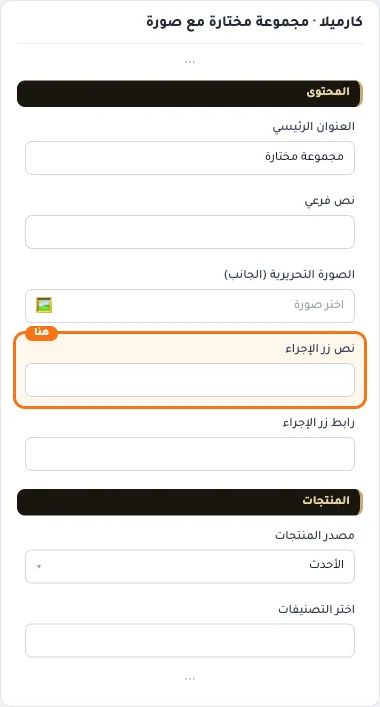

## «رابط زر الإجراء»
اختيار من المتجر · الافتراضي: فارغ

**الوظيفة:** اختر منتجاً أو تصنيفاً أو صفحة تعريفية أو ماركة... أو الصق رابطاً خارجياً.

- **رابط زر الإجراء**
  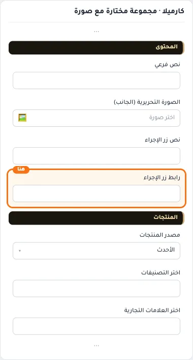

## «مصدر المنتجات»
قائمة منسدلة · الافتراضي: الأحدث

**الوظيفة:** يحدد من أين تأتي منتجات القسم: أحدث المنتجات، أو تصنيفات محددة، أو علامات تجارية، أو منتجات تختارها يدويًا. الحقل المناسب يظهر بعد الاختيار.

- **الأحدث** — القيمة الافتراضية.
  
  
- **تخفيضات**
  
- **عروض**
  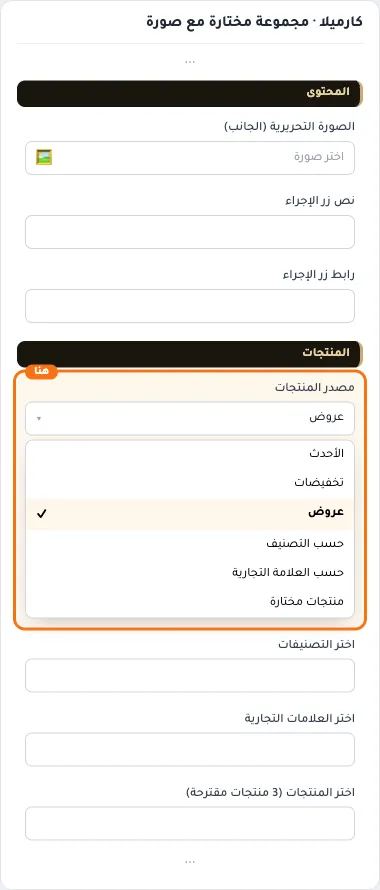
- **حسب التصنيف**
  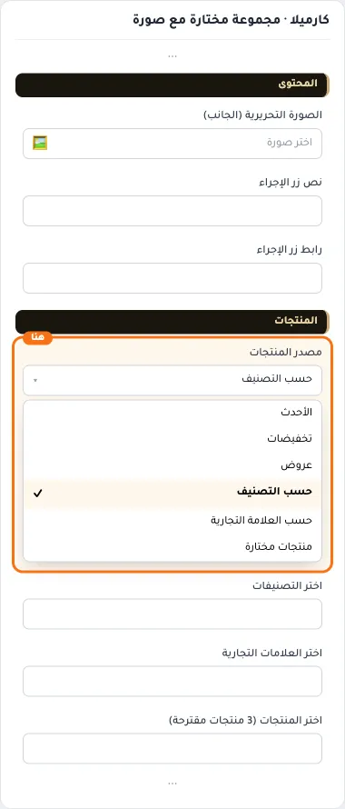
- **حسب العلامة التجارية**
  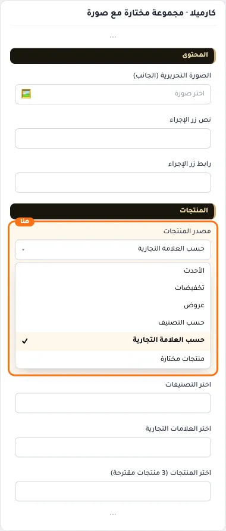
- **منتجات مختارة**
  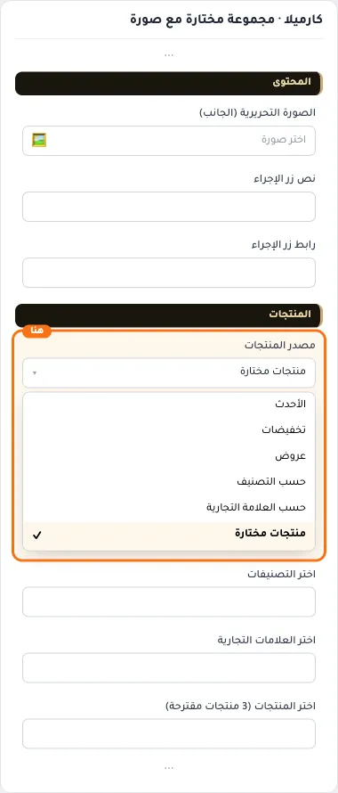

## «اختر التصنيفات»
اختيار من المتجر · الافتراضي: فارغ

**الوظيفة:** التصنيفات التي تُجلب منها المنتجات؛ يظهر حين يكون المصدر «تصنيفات».

**يظهر حين:** «مصدر المنتجات» = حسب التصنيف

- **اختر التصنيفات**
  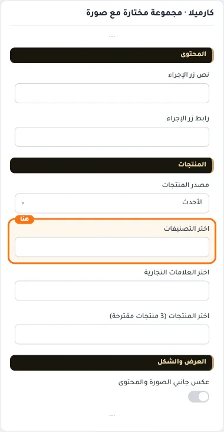

## «اختر العلامات التجارية»
اختيار من المتجر · الافتراضي: فارغ

**الوظيفة:** العلامات التجارية التي تُجلب منها المنتجات؛ يظهر حين يكون المصدر «علامات تجارية».

**يظهر حين:** «مصدر المنتجات» = حسب العلامة التجارية

- **اختر العلامات التجارية**
  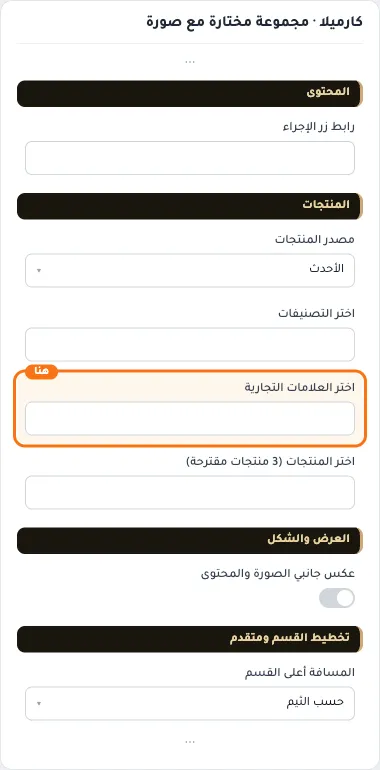

## «اختر المنتجات (3 منتجات مقترحة)»
اختيار من المتجر · الافتراضي: فارغ

**الوظيفة:** المنتجات التي تختارها بنفسك لتظهر في القسم بالترتيب الذي تحدده؛ يظهر حين يكون المصدر «منتجات محددة».

**يظهر حين:** «مصدر المنتجات» = منتجات مختارة

- **اختر المنتجات (3 منتجات مقترحة)**
  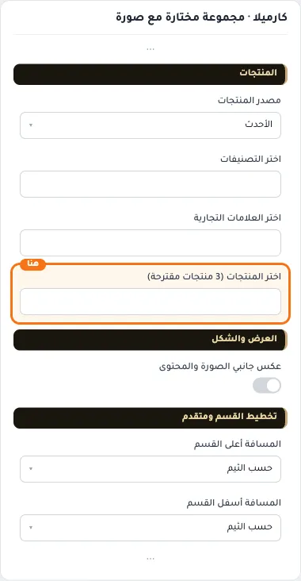

## «عكس جانبي الصورة والمحتوى»
مفتاح · الافتراضي: مطفأ

**الوظيفة:** يبدّل مكان الصورة والنص يمينًا ويسارًا.

- **بعد قلب المفتاح**
  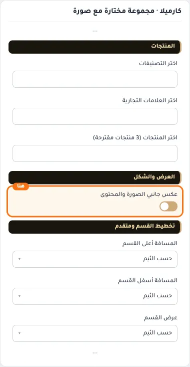

## «كلاس CSS مخصص»
نص · الافتراضي: فارغ

**الوظيفة:** للمصممين. كلاس القسم الثابت: cml-s--cml-curated-collection

- **كلاس CSS مخصص**
  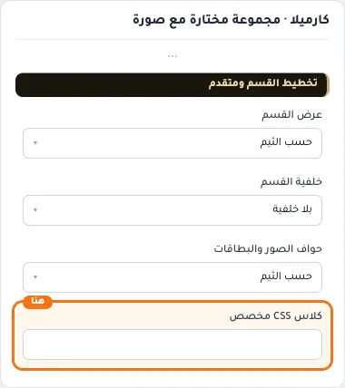
