# كارميلا · بانر CTA

المسافات والعرض والخلفية والحواف: انظر [الخيارات المشتركة](../../01-shared/README.md).

## «عنوان صغير فوق العنوان»
نص · الافتراضي: فارغ

**الوظيفة:** كلمة صغيرة فوق العنوان (مثل «جديد» أو «موسم الصيف») تلفت الانتباه قبل العنوان.

- **عنوان صغير فوق العنوان**
  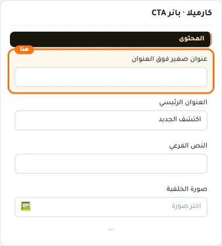

## «العنوان الرئيسي»
نص · الافتراضي: اكتشف الجديد

**الوظيفة:** العنوان الرئيسي الذي يظهر أعلى القسم. اتركه فارغًا لإخفائه.

- **العنوان الرئيسي**
  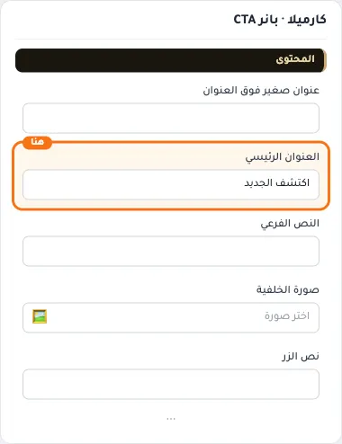

## «النص الفرعي»
نص طويل · الافتراضي: فارغ

**الوظيفة:** سطر قصير تحت العنوان يشرح محتوى القسم. اختياري؛ يختفي إن تُرك فارغًا.

- **النص الفرعي**
  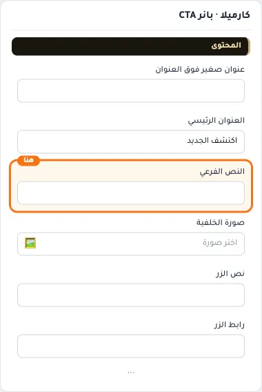

## «صورة الخلفية»
صورة · الافتراضي: فارغ

**الوظيفة:** اتركها فارغة لاستخدام اللون فقط

- **صورة الخلفية**
  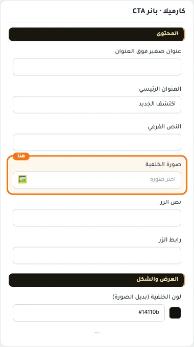

## «نص الزر»
نص · الافتراضي: فارغ

**الوظيفة:** النص المكتوب على الزر. اتركه فارغًا لإخفاء الزر.

- **نص الزر**
  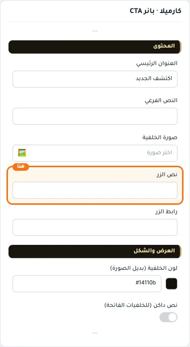

## «رابط الزر»
اختيار من المتجر · الافتراضي: فارغ

**الوظيفة:** اختر منتجاً أو تصنيفاً أو صفحة تعريفية أو ماركة... أو الصق رابطاً خارجياً.

- **رابط الزر**
  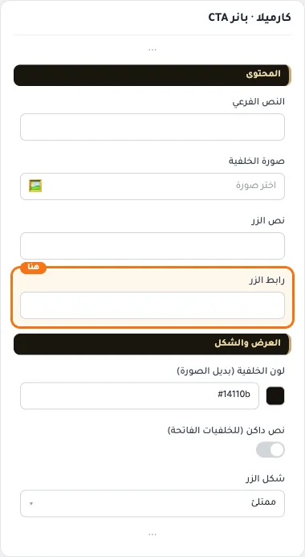

## «لون الخلفية (بديل الصورة)»
لون · الافتراضي: #14110b

**الوظيفة:** لون خلفية يُستخدم حين لا توجد صورة.

- **لون الخلفية (بديل الصورة)**
  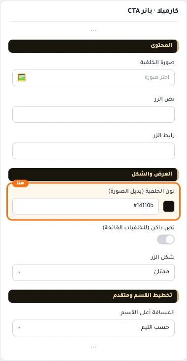

## «نص داكن (للخلفيات الفاتحة)»
مفتاح · الافتراضي: مطفأ

**الوظيفة:** يجعل النص داكنًا ليُقرأ فوق الخلفيات الفاتحة.

- **بعد قلب المفتاح**
  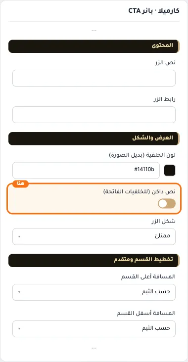

## «شكل الزر»
قائمة منسدلة · الافتراضي: ممتلئ

**الوظيفة:** شكل الزر: ممتلئ أو بإطار أو رابط نصي.

- **ممتلئ** — القيمة الافتراضية.
  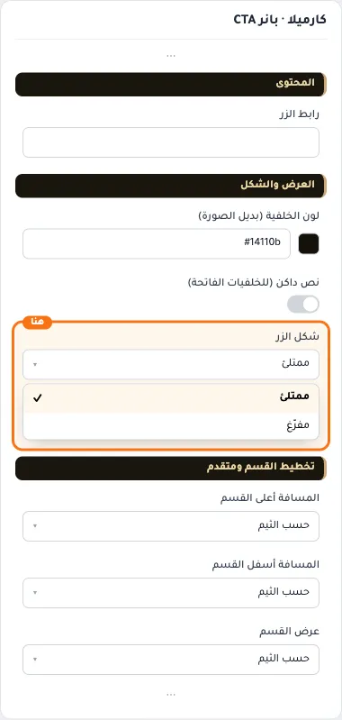
- **مفرّغ**
  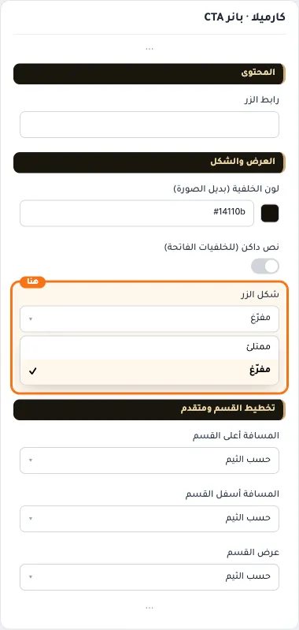

## «كلاس CSS مخصص»
نص · الافتراضي: فارغ

**الوظيفة:** للمصممين. كلاس القسم الثابت: cml-s--cml-cta-banner

- **كلاس CSS مخصص**
  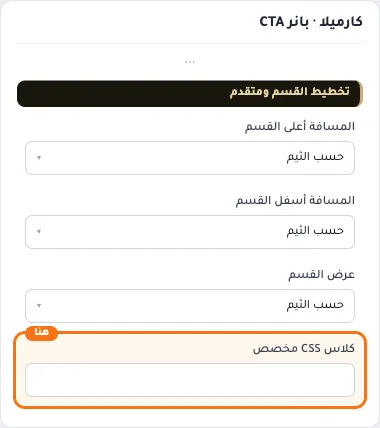
