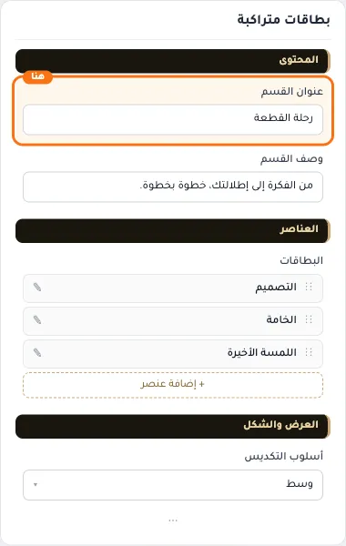
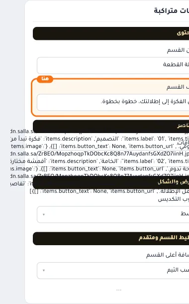
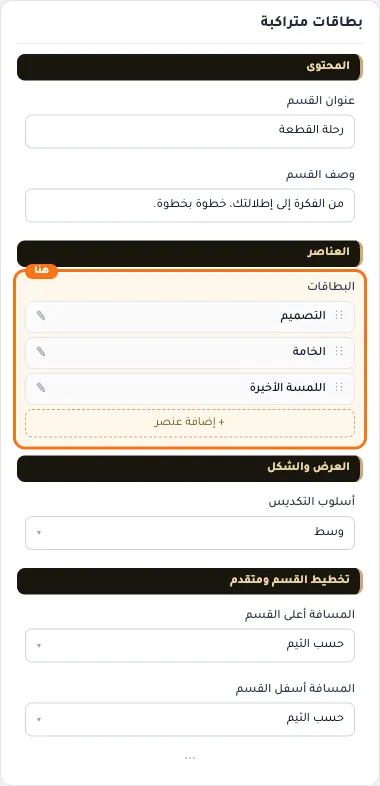
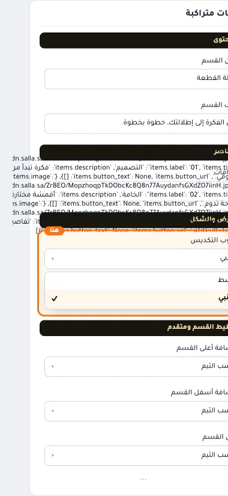
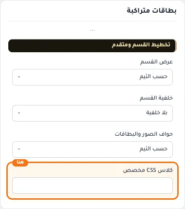

# بطاقات متراكبة

المسافات والعرض والخلفية والحواف: انظر [الخيارات المشتركة](../../01-shared/README.md).

## «عنوان القسم»
نص · الافتراضي: رحلة القطعة

**الوظيفة:** عنوان القسم الظاهر أعلاه. اتركه فارغًا لإخفائه.

- **عنوان القسم**
  

## «وصف القسم»
نص طويل · الافتراضي: من الفكرة إلى إطلالتك، خطوة بخطوة.

**الوظيفة:** وصف قصير تحت عنوان القسم.

- **وصف القسم**
  

## «البطاقات»
عناصر متكررة · الافتراضي: عناصر جاهزة

**الوظيفة:** قائمة العناصر التي يعرضها القسم؛ أضف عنصرًا أو احذفه أو اسحبه لتغيير الترتيب.

- **البطاقات**
  

**حقول كل عنصر:**
- «الصورة» (صورة، الافتراضي: فارغ): الصورة المعروضة في هذا العنصر.
- «التسمية» (نص، الافتراضي: فارغ): النص الظاهر على العنصر.
- «العنوان» (نص، الافتراضي: فارغ): العنوان الرئيسي الذي يظهر أعلى القسم. اتركه فارغًا لإخفائه.
- «الوصف» (نص طويل، الافتراضي: فارغ): نص توضيحي يظهر مع العنوان لشرح العرض أو المجموعة.
- «نص الزر» (نص، الافتراضي: فارغ): النص المكتوب على الزر.
- «رابط الزر» (اختيار من المتجر، الافتراضي: فارغ): اختر منتجاً أو تصنيفاً أو صفحة تعريفية أو ماركة… أو الصق رابطاً خارجياً.

## «أسلوب التكديس»
قائمة منسدلة · الافتراضي: وسط

**الوظيفة:** طريقة تكدّس البطاقات فوق بعضها أثناء التمرير.

- **وسط** — القيمة الافتراضية.
  
  
- **جانبي**
  

## «كلاس CSS مخصص»
نص · الافتراضي: فارغ

**الوظيفة:** للمصممين. كلاس القسم الثابت: cml-s--stacked-cards

- **كلاس CSS مخصص**
  
