# عرض أفقي متحرك

المسافات والعرض والخلفية والحواف: انظر [الخيارات المشتركة](../../01-shared/README.md).

## «عنوان القسم»
نص · الافتراضي: تشكيلات الموسم

**الوظيفة:** عنوان القسم الظاهر أعلاه. اتركه فارغًا لإخفائه.

- **عنوان القسم**
  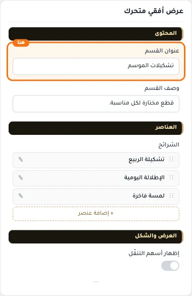

## «وصف القسم»
نص طويل · الافتراضي: قطع مختارة لكل مناسبة.

**الوظيفة:** وصف قصير تحت عنوان القسم.

- **وصف القسم**
  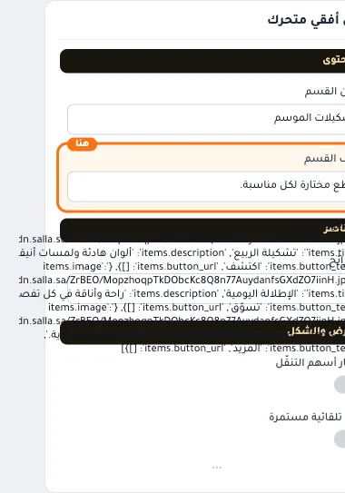

## «الشرائح»
عناصر متكررة · الافتراضي: عناصر جاهزة

**الوظيفة:** قائمة العناصر التي يعرضها القسم؛ أضف عنصرًا أو احذفه أو اسحبه لتغيير الترتيب.

- **الشرائح**
  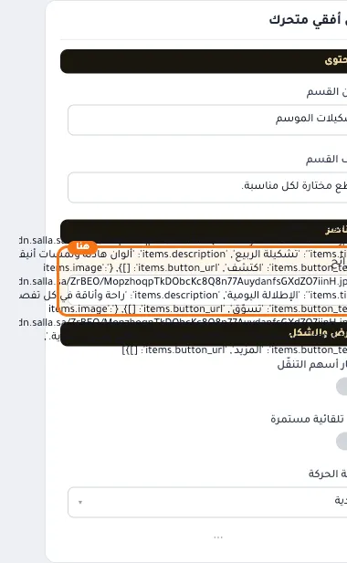

**حقول كل عنصر:**
- «الصورة» (صورة، الافتراضي: فارغ): الصورة المعروضة في هذا العنصر.
- «العنوان» (نص، الافتراضي: فارغ): العنوان الرئيسي الذي يظهر أعلى القسم. اتركه فارغًا لإخفائه.
- «الوصف» (نص طويل، الافتراضي: فارغ): نص توضيحي يظهر مع العنوان لشرح العرض أو المجموعة.
- «نص الزر» (نص، الافتراضي: فارغ): النص المكتوب على الزر.
- «رابط الزر» (اختيار من المتجر، الافتراضي: فارغ): اختر منتجاً أو تصنيفاً أو صفحة تعريفية أو ماركة… أو الصق رابطاً خارجياً.

## «إظهار أسهم التنقّل»
مفتاح · الافتراضي: مطفأ

**الوظيفة:** مطفأة افتراضيًّا. الشريط يُسحب بالإصبع وبعجلة الفأرة، وتظهر الأسهم فوق الصور عند تفعيلها.

- **بعد قلب المفتاح**
  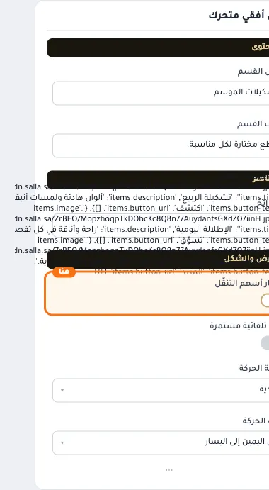

## «حركة تلقائية مستمرة»
مفتاح · الافتراضي: مطفأ

**الوظيفة:** تتحرّك الشرائح من نفسها في حلقة لا تنتهي، بلا حاجة للتمرير. تتوقّف عند التأشير لتتيح النقر.

- **بعد قلب المفتاح**
  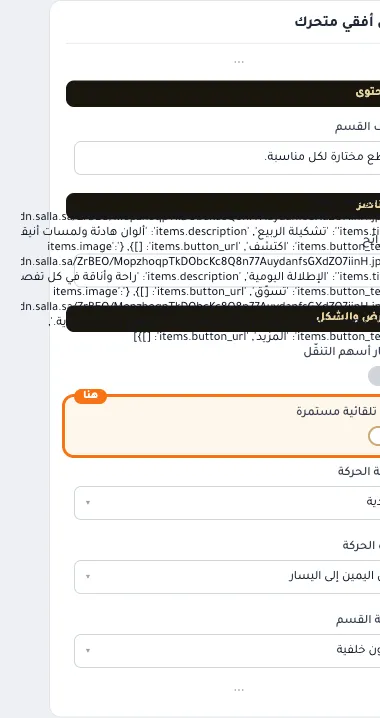

## «سرعة الحركة»
قائمة منسدلة · الافتراضي: عادية

**الوظيفة:** تُحسب لكل شريحة، فالسرعة نفسها مهما زاد عددها.

**يظهر حين:** «حركة تلقائية مستمرة» = مفعّل

- **هادئة**
  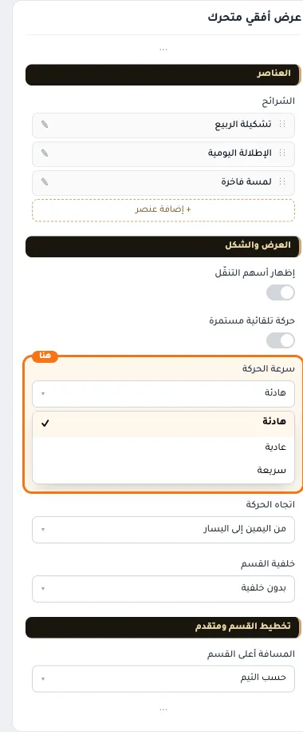
- **عادية** — القيمة الافتراضية.
  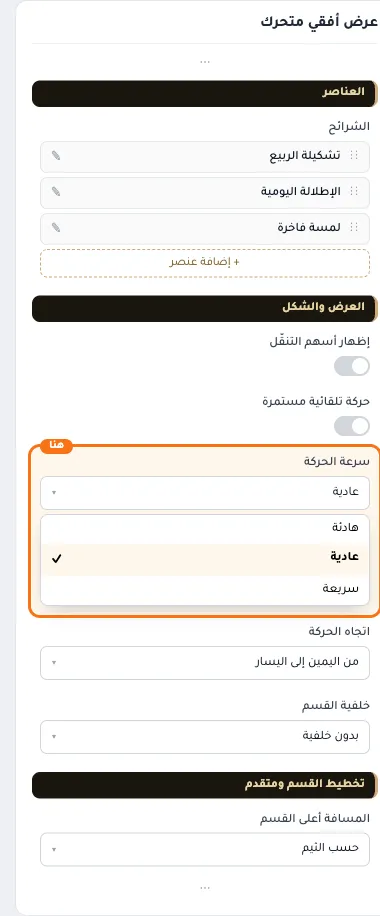
  
- **سريعة**
  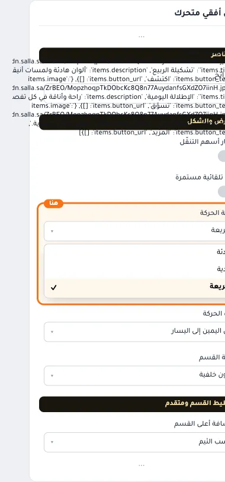

## «اتجاه الحركة»
قائمة منسدلة · الافتراضي: من اليمين إلى اليسار

**الوظيفة:** اتجاه دوران الشرائح.

**يظهر حين:** «حركة تلقائية مستمرة» = مفعّل

- **من اليمين إلى اليسار** — القيمة الافتراضية.
  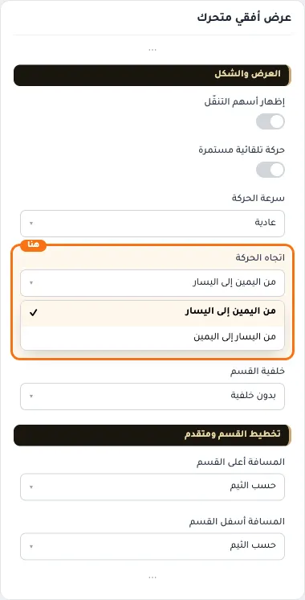
  
- **من اليسار إلى اليمين**
  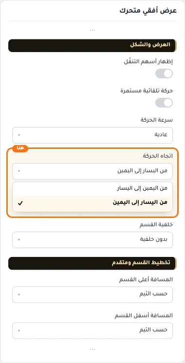

## «خلفية القسم»
قائمة منسدلة · الافتراضي: بدون خلفية

**الوظيفة:** بدون خلفية: الشرائح على خلفية الصفحة مباشرة. بخلفية: شريط هادئ خلف القسم كله.

- **بدون خلفية** — القيمة الافتراضية.
  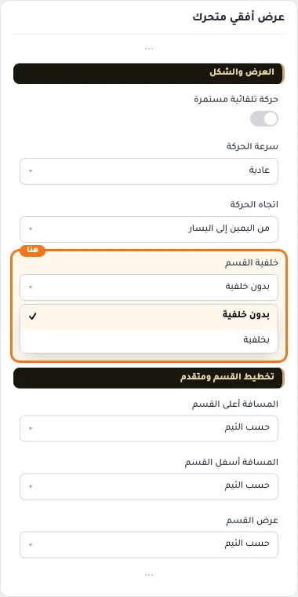
  
- **بخلفية**
  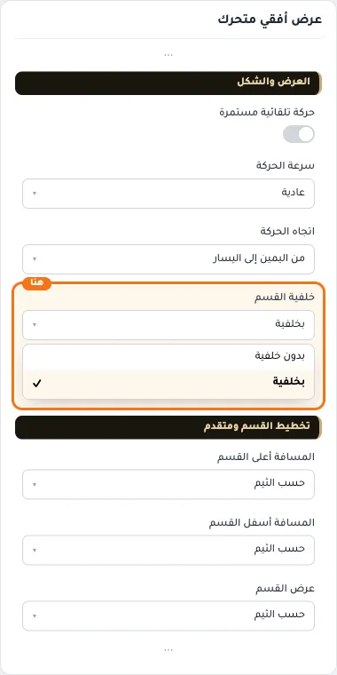

## «كلاس CSS مخصص»
نص · الافتراضي: فارغ

**الوظيفة:** للمصممين. كلاس القسم الثابت: cml-s--horizontal-showcase

- **كلاس CSS مخصص**
  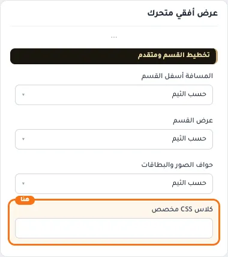
