# كارميلا · معرض إنستغرام

المسافات والعرض والخلفية والحواف: انظر [الخيارات المشتركة](../../01-shared/README.md).

## «عنوان القسم»
نص · الافتراضي: تابعنا على إنستغرام

**الوظيفة:** عنوان القسم الظاهر أعلاه. اتركه فارغًا لإخفائه.

- **عنوان القسم**
  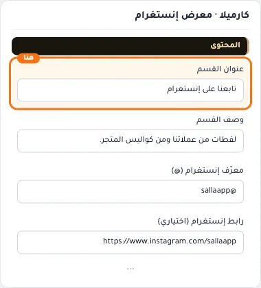

## «وصف القسم»
نص طويل · الافتراضي: لقطات من عملائنا ومن كواليس المتجر.

**الوظيفة:** وصف قصير تحت عنوان القسم.

- **وصف القسم**
  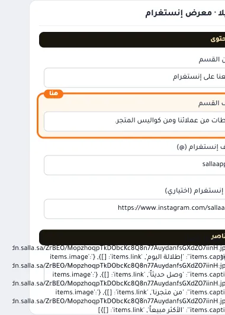

## «معرّف إنستغرام (@)»
نص · الافتراضي: @sallaapp

**الوظيفة:** اسم حساب إنستغرام الذي يظهر ويفتحه الزر.

- **معرّف إنستغرام (@)**
  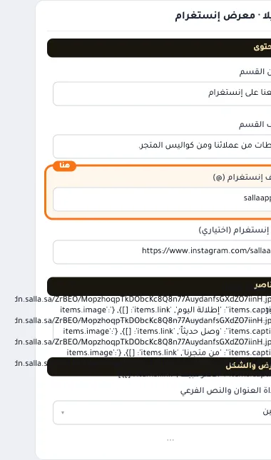

## «رابط إنستغرام (اختياري)»
نص · الافتراضي: https://www.instagram.com/sallaapp

**الوظيفة:** اتركه فارغاً ليُبنى تلقائياً من المعرّف.

- **رابط إنستغرام (اختياري)**
  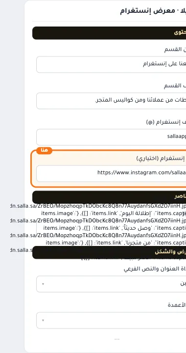

## «الصور»
عناصر متكررة · الافتراضي: عناصر جاهزة

**الوظيفة:** قائمة العناصر التي يعرضها القسم؛ أضف عنصرًا أو احذفه أو اسحبه لتغيير الترتيب.

- **الصور**
  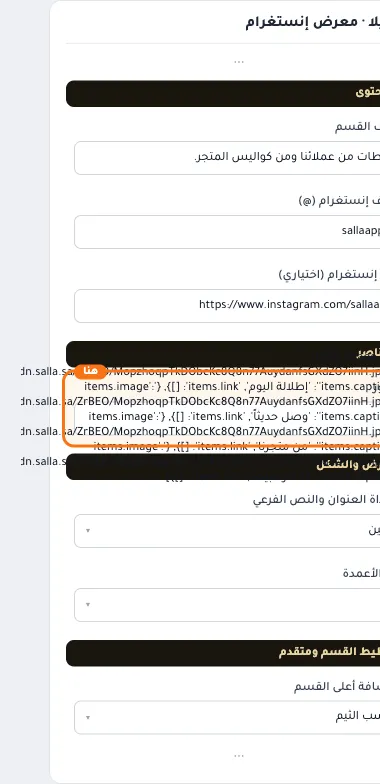

**حقول كل عنصر:**
- «الصورة» (صورة، الافتراضي: فارغ): الصورة المعروضة في هذا العنصر.
- «التعليق» (نص، الافتراضي: فارغ): التعليق الذي يظهر عند التأشير على الصورة.
- «الرابط» (اختيار من المتجر، الافتراضي: فارغ): الصفحة التي يفتحها الضغط على العنصر.

## «محاذاة العنوان والنص الفرعي»
قائمة منسدلة · الافتراضي: يمين

**الوظيفة:** محاذاة عنوان القسم ووصفه (الافتراضي: يمين).

- **يمين** — القيمة الافتراضية.
  
  
- **وسط**
  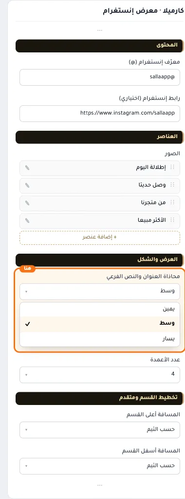
- **يسار**
  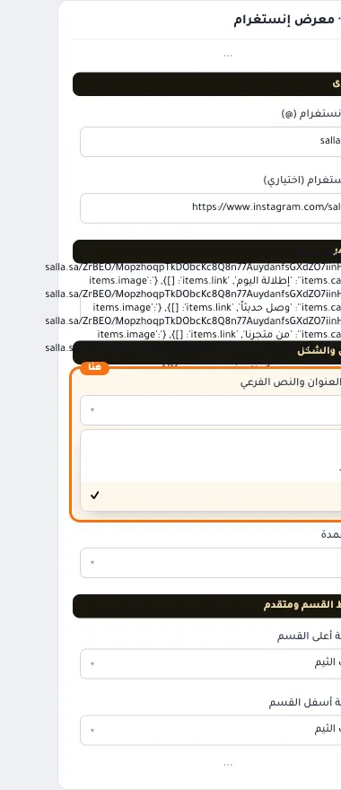

## «عدد الأعمدة»
قائمة منسدلة · الافتراضي: 4

**الوظيفة:** عدد الأعمدة التي تتوزع عليها العناصر.

- **3**
  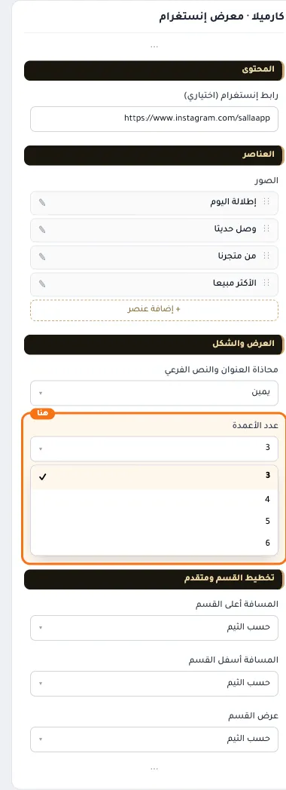
- **4** — القيمة الافتراضية.
  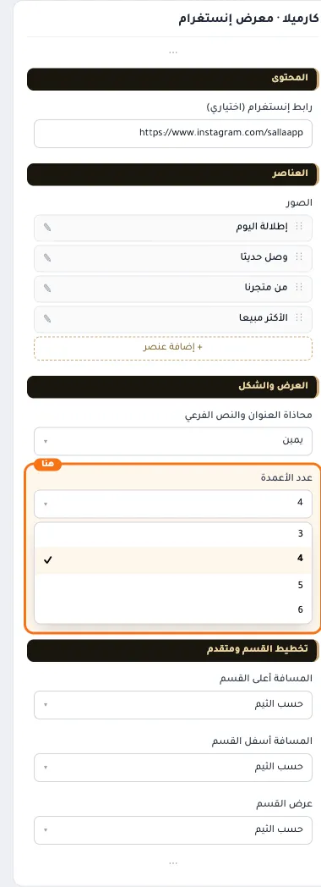
  
- **5**
  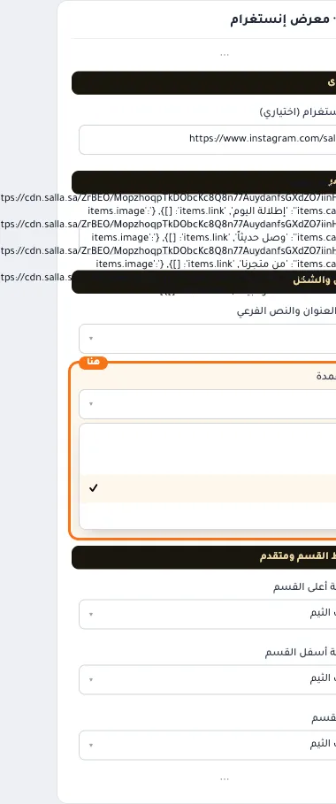
- **6**
  

## «كلاس CSS مخصص»
نص · الافتراضي: فارغ

**الوظيفة:** للمصممين. كلاس القسم الثابت: cml-s--cml-instagram

- **كلاس CSS مخصص**
  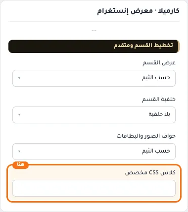
