# كارميلا · أرقام تحكي القصة

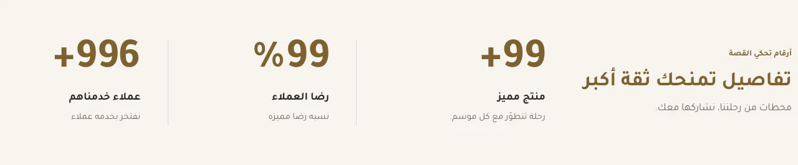

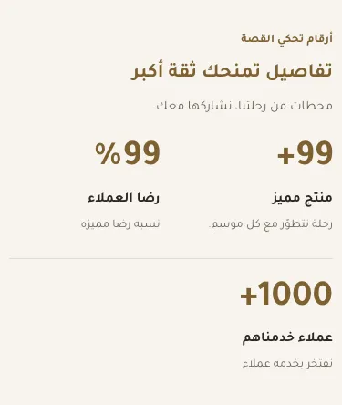

المسافات والعرض والخلفية والحواف: انظر [الخيارات المشتركة](../../01-shared/README.md).

## «عنوان تمهيدي»
نص · الافتراضي: المتجر في أرقام

**الوظيفة:** سطر صغير فوق العنوان. اتركه فارغًا لإخفائه.

- **عنوان تمهيدي**
  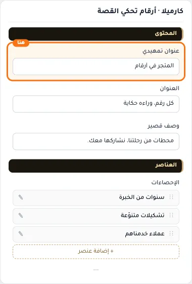

## «العنوان»
نص · الافتراضي: كل رقم، وراءه حكاية

**الوظيفة:** عنوان القسم.

- **العنوان**
  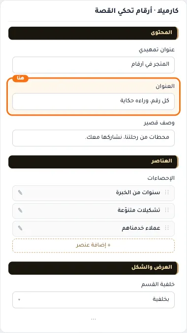

## «وصف قصير»
نص طويل · الافتراضي: محطات من رحلتنا، نشاركها معك.

**الوظيفة:** سطر واحد تحت العنوان. اتركه فارغًا لإخفائه.

- **وصف قصير**
  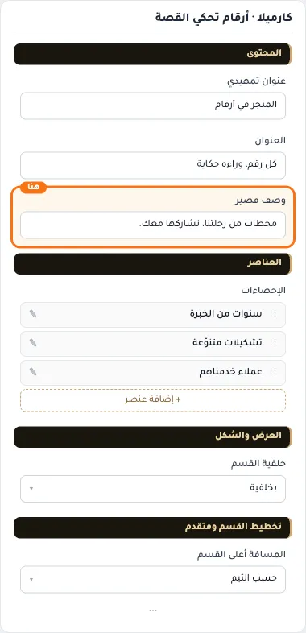

## «الإحصاءات»
عناصر متكررة · الافتراضي: عناصر جاهزة

**الوظيفة:** من إحصاء واحد إلى أربعة. لا يظهر الإحصاء إلا إذا كُتبت قيمته وعنوانه.

- **الإحصاءات**
  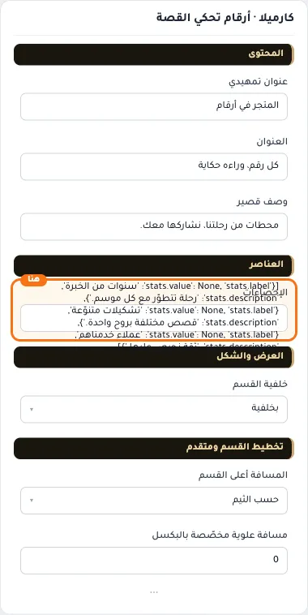

**حقول كل عنصر:**
- «أيقونة (اختياري)» (أيقونة، الافتراضي: فارغ): من مكتبة أيقونات سلة. اتركها فارغة لإخفائها.
- «القيمة» (نص، الافتراضي: فارغ): كما تريدها أن تُعرض: 12 أو 2,500 أو 98% أو +5. تُطبع كما تُكتب.
- «العنوان» (نص، الافتراضي: فارغ): ما الذي يعنيه الرقم.
- «وصف اختياري» (نص، الافتراضي: فارغ): سطر قصير تحت العنوان. اتركه فارغًا لإخفائه.

## «خلفية القسم»
قائمة منسدلة · الافتراضي: بخلفية

**الوظيفة:** لوحة بخلفية وحدّ خفيف، أو بدون خلفية فتظهر الأرقام على خلفية الصفحة مباشرة.

- **بخلفية** — القيمة الافتراضية.
  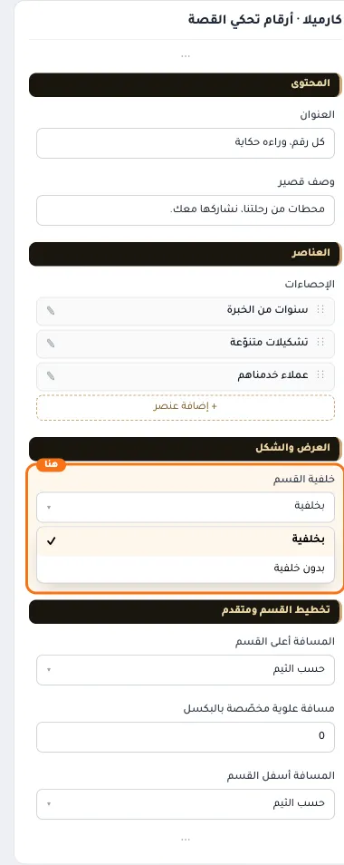
  
- **بدون خلفية**
  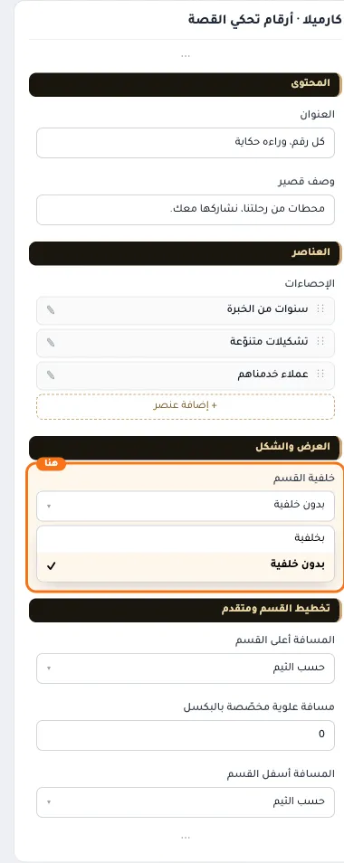

## «مسافة علوية مخصّصة بالبكسل»
رقم · الافتراضي: 0

**الوظيفة:** اختياري. يعمل حين تكون «المسافة أعلى القسم» على «حسب الثيم».

**يظهر حين:** «المسافة أعلى القسم» = حسب الثيم

- **مسافة علوية مخصّصة بالبكسل**
  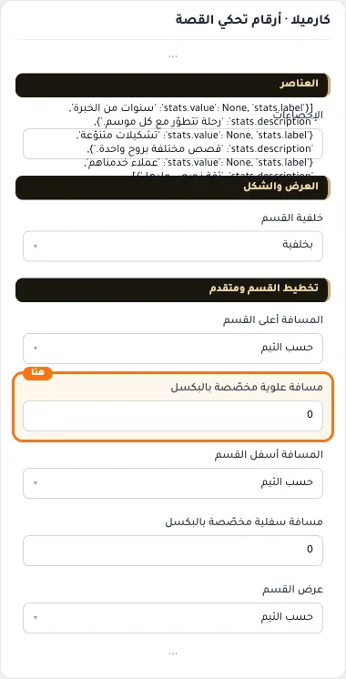

## «مسافة سفلية مخصّصة بالبكسل»
رقم · الافتراضي: 0

**الوظيفة:** اختياري. يعمل حين تكون «المسافة أسفل القسم» على «حسب الثيم».

**يظهر حين:** «المسافة أسفل القسم» = حسب الثيم

- **مسافة سفلية مخصّصة بالبكسل**
  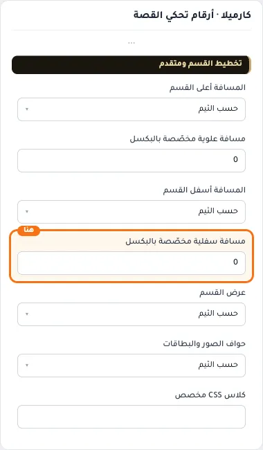

## «كلاس CSS مخصص»
نص · الافتراضي: فارغ

**الوظيفة:** للمصممين. كلاس القسم الثابت: cml-s--cml-brand-numbers

- **كلاس CSS مخصص**
  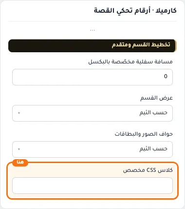
