# كارميلا · اكتشف بالسحب

المسافات والعرض والخلفية والحواف: انظر [الخيارات المشتركة](../../01-shared/README.md).

## «عنوان تمهيدي صغير»
نص · الافتراضي: اختيارات تناسبك

**الوظيفة:** سطر صغير فوق العنوان. اتركه فارغًا لإخفائه.

- **عنوان تمهيدي صغير**
  

## «العنوان»
نص طويل · الافتراضي: اختيارات أسرع. على ذوقك.

**الوظيفة:** كل سطر يظهر في سطر مستقل.

- **العنوان**
  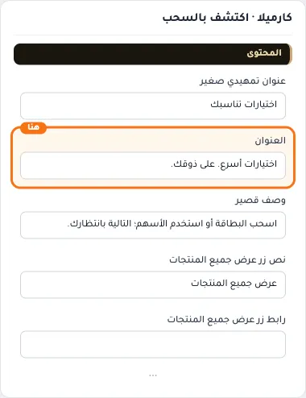

## «وصف قصير»
نص طويل · الافتراضي: اسحب البطاقة أو استخدم الأسهم؛ التالية بانتظارك.

**الوظيفة:** سطر قصير تحت العنوان. اتركه فارغًا لإخفائه.

- **وصف قصير**
  

## «نص زر عرض جميع المنتجات»
نص · الافتراضي: عرض جميع المنتجات

**الوظيفة:** النص المكتوب على زر عرض جميع المنتجات.

- **نص زر عرض جميع المنتجات**
  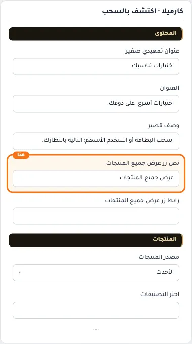

## «رابط زر عرض جميع المنتجات»
اختيار من المتجر · الافتراضي: فارغ

**الوظيفة:** الصفحة التي يفتحها زر عرض جميع المنتجات.

- **رابط زر عرض جميع المنتجات**
  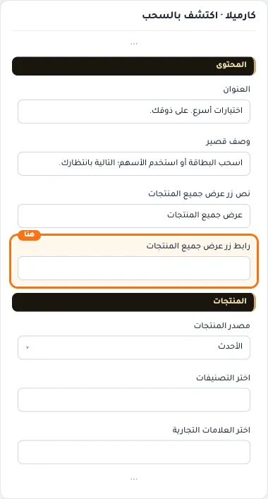

## «مصدر المنتجات»
قائمة منسدلة · الافتراضي: الأحدث

**الوظيفة:** يحدد من أين تأتي منتجات القسم: أحدث المنتجات، أو تصنيفات محددة، أو علامات تجارية، أو منتجات تختارها يدويًا. الحقل المناسب يظهر بعد الاختيار.

- **الأحدث** — القيمة الافتراضية.
  
  
- **الأكثر مبيعاً**
  
- **العروض والتخفيضات**
  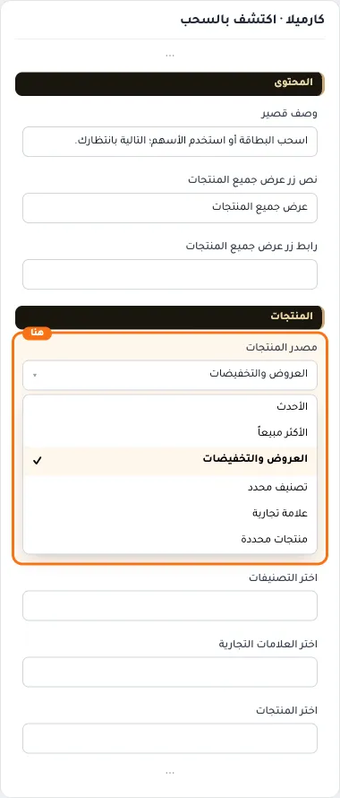
- **تصنيف محدد**
  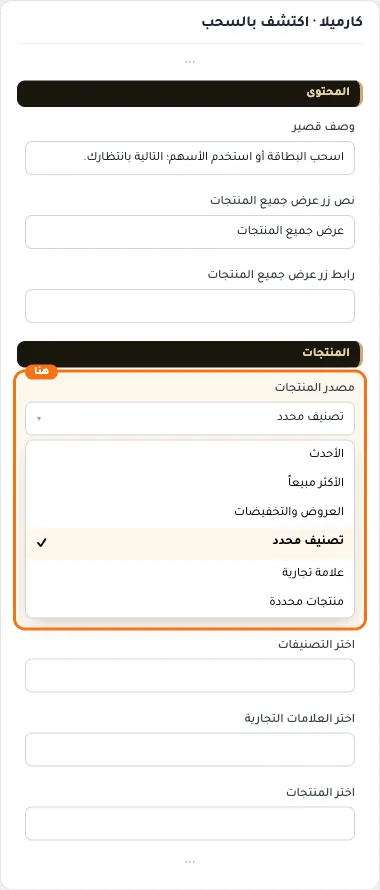
- **علامة تجارية**
  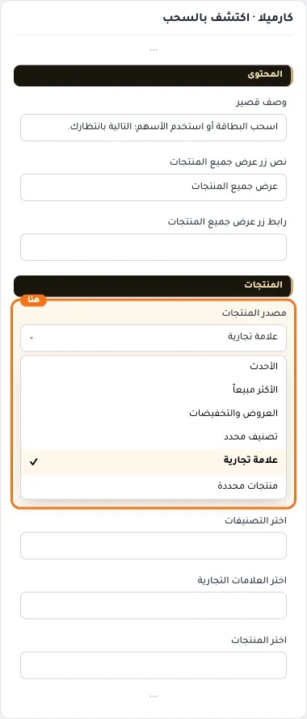
- **منتجات محددة**
  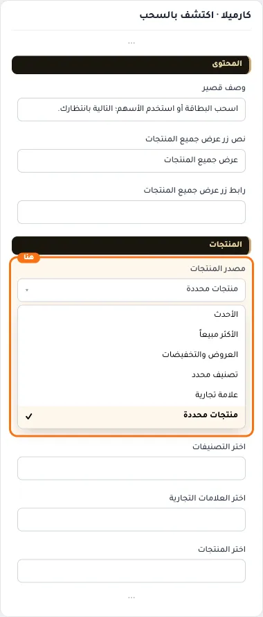

## «اختر التصنيفات»
اختيار من المتجر · الافتراضي: فارغ

**الوظيفة:** التصنيفات التي تُجلب منها المنتجات؛ يظهر حين يكون المصدر «تصنيفات».

**يظهر حين:** «مصدر المنتجات» = تصنيف محدد

- **اختر التصنيفات**
  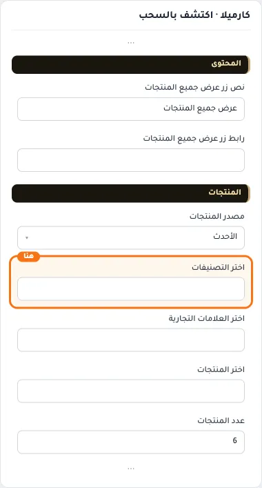

## «اختر العلامات التجارية»
اختيار من المتجر · الافتراضي: فارغ

**الوظيفة:** العلامات التجارية التي تُجلب منها المنتجات؛ يظهر حين يكون المصدر «علامات تجارية».

**يظهر حين:** «مصدر المنتجات» = علامة تجارية

- **اختر العلامات التجارية**
  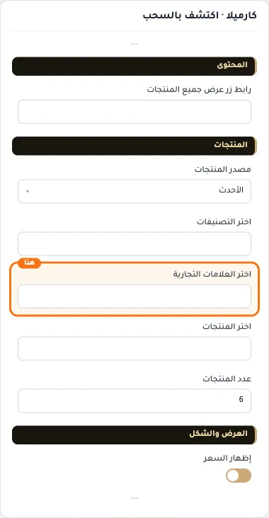

## «اختر المنتجات»
اختيار من المتجر · الافتراضي: فارغ

**الوظيفة:** المنتجات التي تختارها بنفسك لتظهر في القسم بالترتيب الذي تحدده؛ يظهر حين يكون المصدر «منتجات محددة».

**يظهر حين:** «مصدر المنتجات» = منتجات محددة

- **اختر المنتجات**
  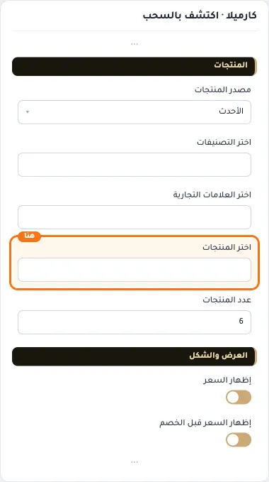

## «عدد المنتجات»
رقم · الافتراضي: 6

**الوظيفة:** من 4 إلى 12.

- **عدد المنتجات**
  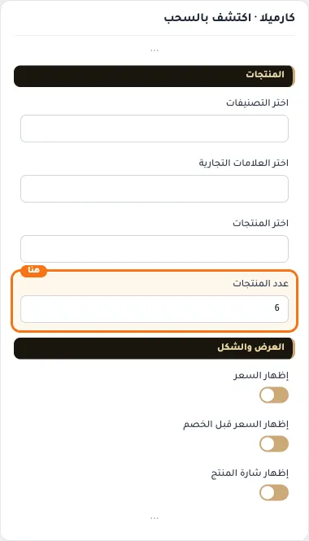

## «إظهار السعر»
مفتاح · الافتراضي: مفعّل

**الوظيفة:** يظهر سعر المنتج على البطاقة أو يخفيه.

- **بعد قلب المفتاح**
  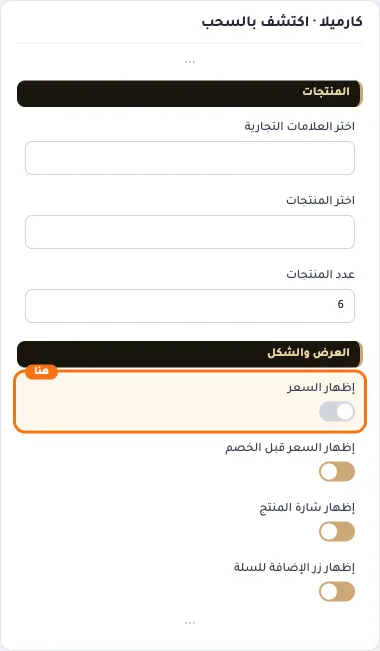

## «إظهار السعر قبل الخصم»
مفتاح · الافتراضي: مفعّل

**الوظيفة:** يظهر السعر الأصلي مشطوبًا بجانب سعر الخصم.

- **بعد قلب المفتاح**
  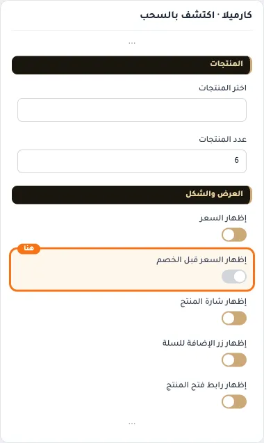

## «إظهار شارة المنتج»
مفتاح · الافتراضي: مفعّل

**الوظيفة:** يظهر شارة المنتج (جديد، خصم، نفد…) على البطاقة.

- **بعد قلب المفتاح**
  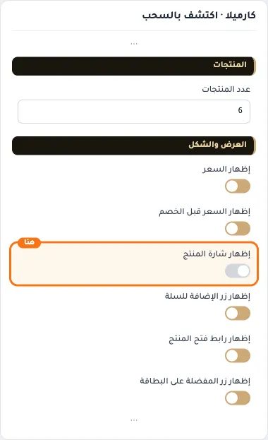

## «إظهار زر الإضافة للسلة»
مفتاح · الافتراضي: مفعّل

**الوظيفة:** يظهر زر الإضافة للسلة على البطاقة.

- **بعد قلب المفتاح**
  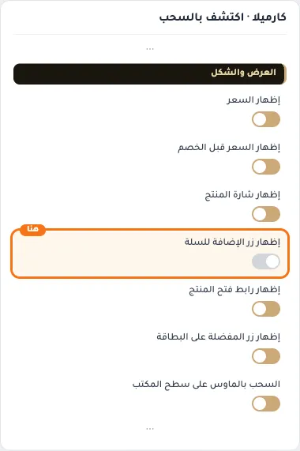

## «إظهار رابط فتح المنتج»
مفتاح · الافتراضي: مفعّل

**الوظيفة:** يظهر رابطًا لفتح صفحة المنتج كاملة.

- **بعد قلب المفتاح**
  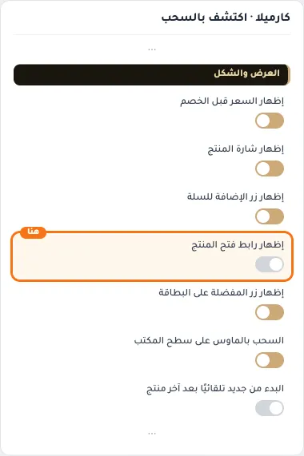

## «إظهار زر المفضلة على البطاقة»
مفتاح · الافتراضي: مفعّل

**الوظيفة:** يظهر زر المفضلة (القلب) على البطاقة.

- **بعد قلب المفتاح**
  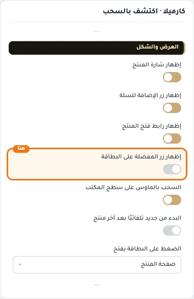

## «السحب بالماوس على سطح المكتب»
مفتاح · الافتراضي: مفعّل

**الوظيفة:** يسمح بسحب السلايدر بالماوس على الكمبيوتر.

- **بعد قلب المفتاح**
  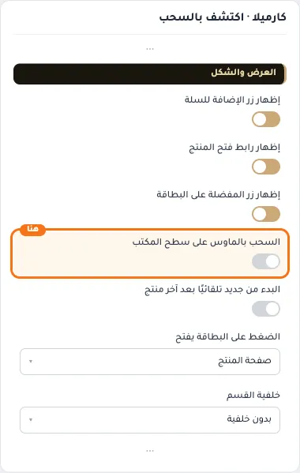

## «البدء من جديد تلقائيًا بعد آخر منتج»
مفتاح · الافتراضي: مطفأ

**الوظيفة:** يعود للمنتج الأول تلقائيًا بعد آخر منتج.

- **بعد قلب المفتاح**
  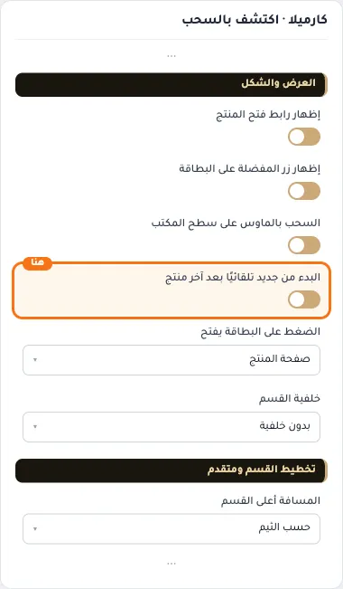

## «الضغط على البطاقة يفتح»
قائمة منسدلة · الافتراضي: صفحة المنتج

**الوظيفة:** ما يحدث عند الضغط على البطاقة: فتح صفحة المنتج أو العرض السريع.

- **صفحة المنتج** — القيمة الافتراضية.
  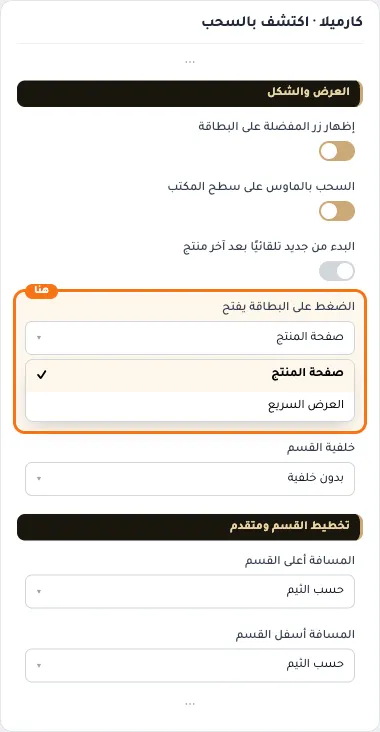
  
- **العرض السريع**
  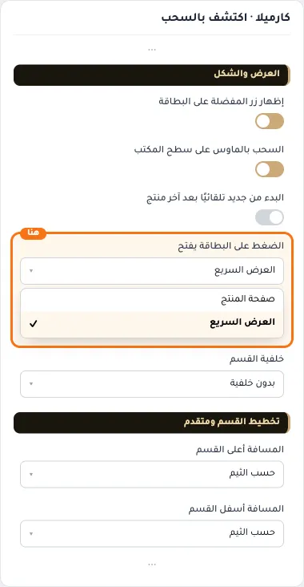

## «خلفية القسم»
قائمة منسدلة · الافتراضي: بدون خلفية

**الوظيفة:** خلفية القسم: بلا خلفية، أو لون سطح، أو لون ناعم، أو لون تختاره.

- **بدون خلفية** — القيمة الافتراضية.
  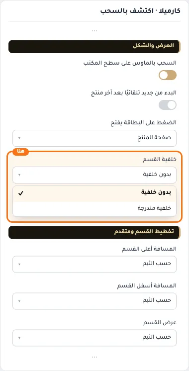
  
- **خلفية متدرجة**
  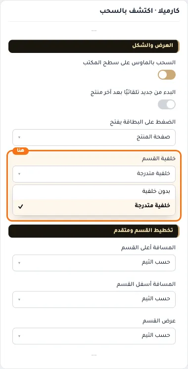

## «كلاس CSS مخصص»
نص · الافتراضي: فارغ

**الوظيفة:** للمصممين. كلاس القسم الثابت: cml-s--cml-swipe-discovery

- **كلاس CSS مخصص**
  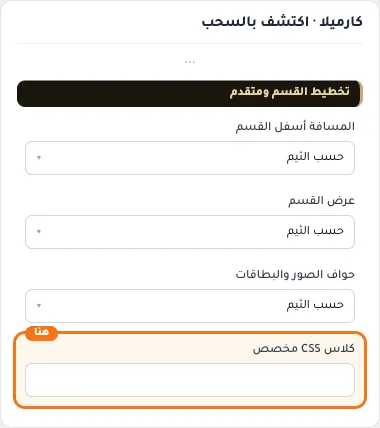
