# كارميلا · شبكة المنتجات التحريرية

المسافات والعرض والخلفية والحواف: انظر [الخيارات المشتركة](../../01-shared/README.md).

## «العنوان»
نص · الافتراضي: مختارات تحريرية

**الوظيفة:** العنوان الرئيسي الذي يظهر أعلى القسم. اتركه فارغًا لإخفائه.

- **العنوان**
  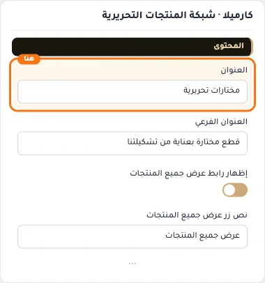

## «العنوان الفرعي»
نص · الافتراضي: قطع مختارة بعناية من تشكيلتنا

**الوظيفة:** سطر قصير تحت العنوان يشرح محتوى القسم. اختياري؛ يختفي إن تُرك فارغًا.

- **العنوان الفرعي**
  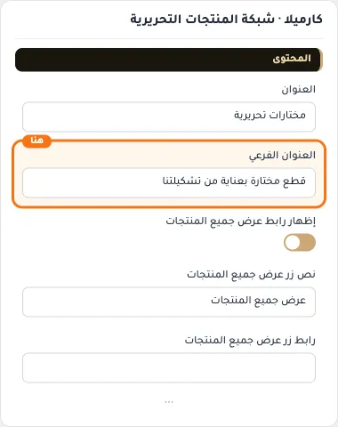

## «إظهار رابط عرض جميع المنتجات»
مفتاح · الافتراضي: مفعّل

**الوظيفة:** يظهر رابط «عرض جميع المنتجات».

- **بعد قلب المفتاح**
  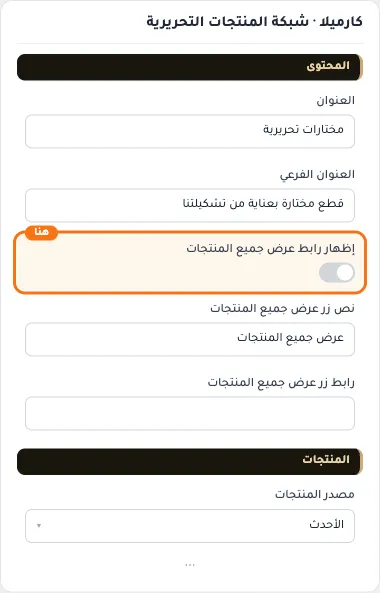

## «نص زر عرض جميع المنتجات»
نص · الافتراضي: عرض جميع المنتجات

**الوظيفة:** النص المكتوب على زر عرض جميع المنتجات.

- **نص زر عرض جميع المنتجات**
  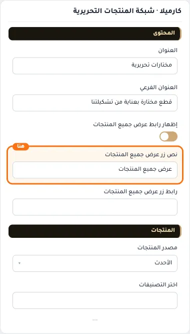

## «رابط زر عرض جميع المنتجات»
اختيار من المتجر · الافتراضي: فارغ

**الوظيفة:** الصفحة التي يفتحها زر عرض جميع المنتجات.

- **رابط زر عرض جميع المنتجات**
  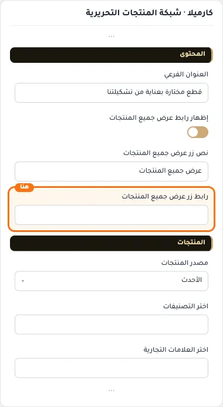

## «مصدر المنتجات»
قائمة منسدلة · الافتراضي: الأحدث

**الوظيفة:** يحدد من أين تأتي منتجات القسم: أحدث المنتجات، أو تصنيفات محددة، أو علامات تجارية، أو منتجات تختارها يدويًا. الحقل المناسب يظهر بعد الاختيار.

- **الأحدث** — القيمة الافتراضية.
  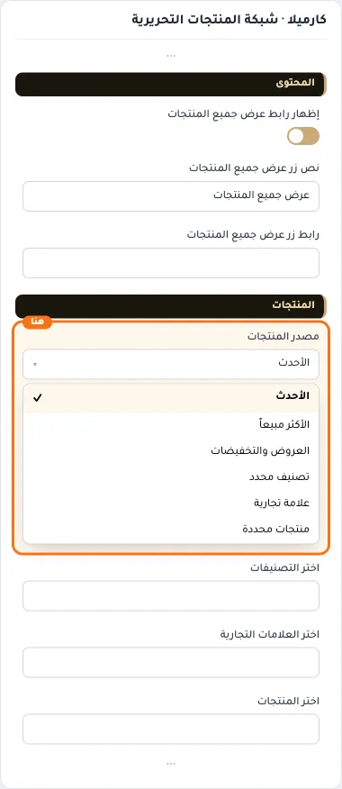
  
- **الأكثر مبيعاً**
  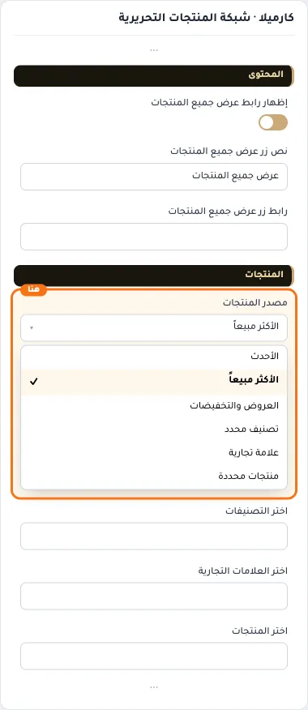
- **العروض والتخفيضات**
  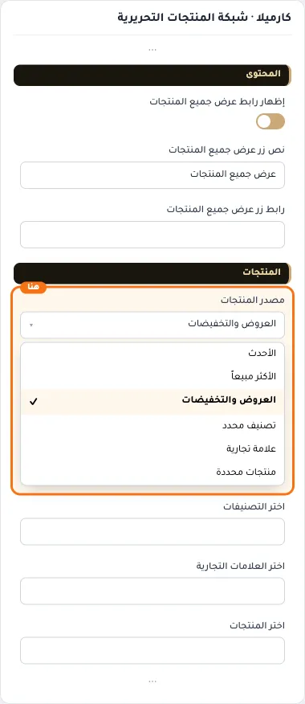
- **تصنيف محدد**
  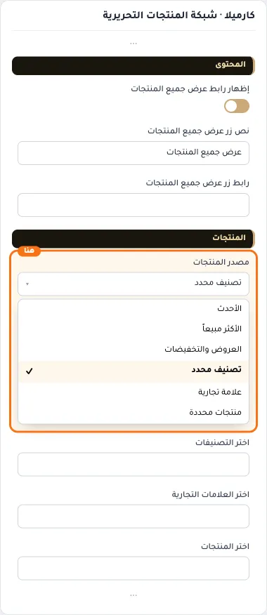
- **علامة تجارية**
  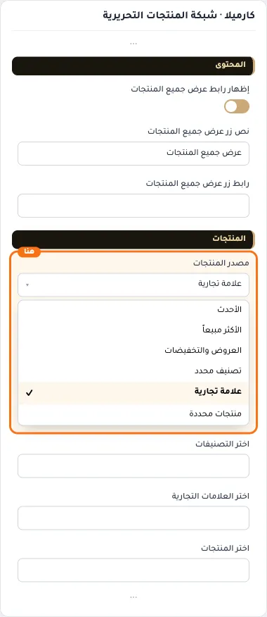
- **منتجات محددة**
  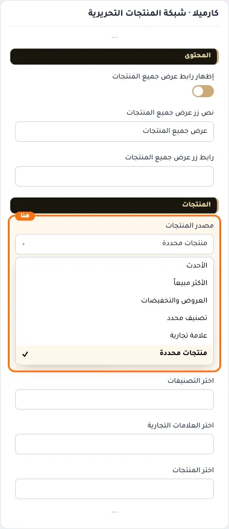

## «اختر التصنيفات»
اختيار من المتجر · الافتراضي: فارغ

**الوظيفة:** التصنيفات التي تُجلب منها المنتجات؛ يظهر حين يكون المصدر «تصنيفات».

**يظهر حين:** «مصدر المنتجات» = تصنيف محدد

- **اختر التصنيفات**
  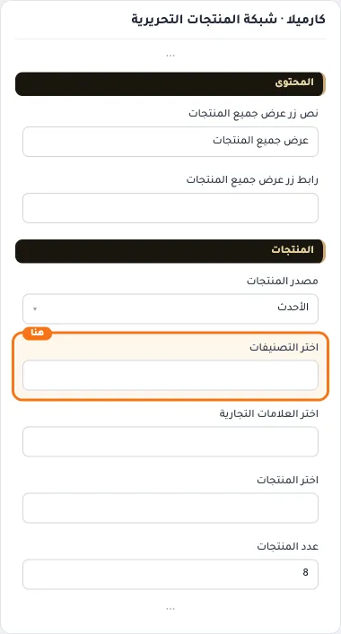

## «اختر العلامات التجارية»
اختيار من المتجر · الافتراضي: فارغ

**الوظيفة:** العلامات التجارية التي تُجلب منها المنتجات؛ يظهر حين يكون المصدر «علامات تجارية».

**يظهر حين:** «مصدر المنتجات» = علامة تجارية

- **اختر العلامات التجارية**
  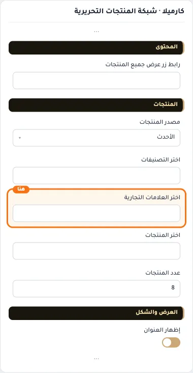

## «اختر المنتجات»
اختيار من المتجر · الافتراضي: فارغ

**الوظيفة:** المنتجات التي تختارها بنفسك لتظهر في القسم بالترتيب الذي تحدده؛ يظهر حين يكون المصدر «منتجات محددة».

**يظهر حين:** «مصدر المنتجات» = منتجات محددة

- **اختر المنتجات**
  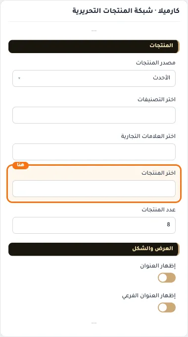

## «عدد المنتجات»
رقم · الافتراضي: 8

**الوظيفة:** من 6 إلى 8.

- **عدد المنتجات**
  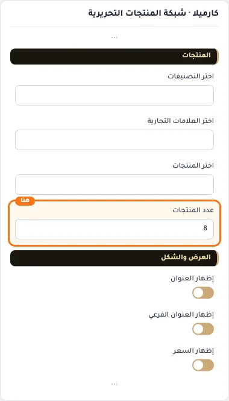

## «إظهار العنوان»
مفتاح · الافتراضي: مفعّل

**الوظيفة:** يظهر عنوان القسم أو يخفيه.

- **بعد قلب المفتاح**
  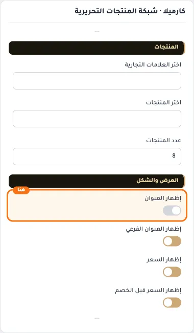

## «إظهار العنوان الفرعي»
مفتاح · الافتراضي: مفعّل

**الوظيفة:** يظهر العنوان الفرعي أو يخفيه.

- **بعد قلب المفتاح**
  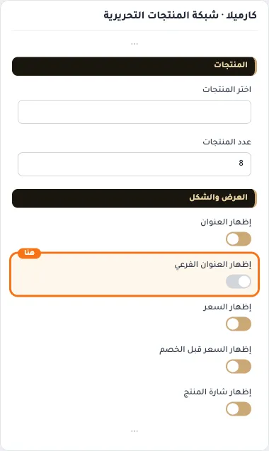

## «إظهار السعر»
مفتاح · الافتراضي: مفعّل

**الوظيفة:** يظهر سعر المنتج على البطاقة أو يخفيه.

- **بعد قلب المفتاح**
  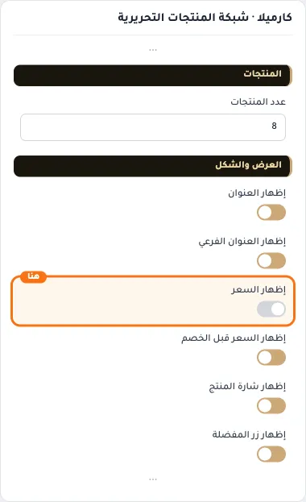

## «إظهار السعر قبل الخصم»
مفتاح · الافتراضي: مفعّل

**الوظيفة:** يظهر السعر الأصلي مشطوبًا بجانب سعر الخصم.

- **بعد قلب المفتاح**
  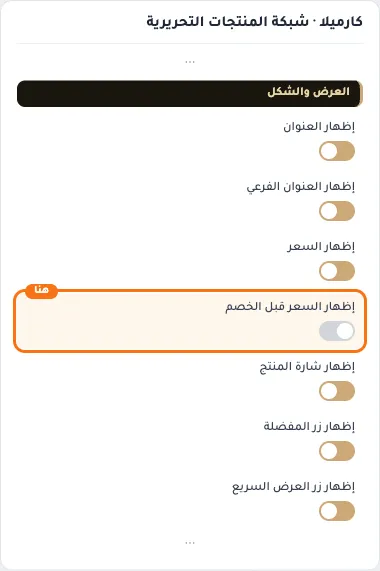

## «إظهار شارة المنتج»
مفتاح · الافتراضي: مفعّل

**الوظيفة:** يظهر شارة المنتج (جديد، خصم، نفد…) على البطاقة.

- **بعد قلب المفتاح**
  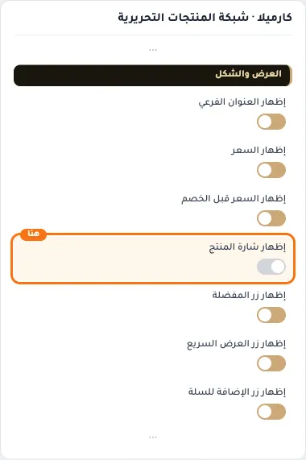

## «إظهار زر المفضلة»
مفتاح · الافتراضي: مفعّل

**الوظيفة:** يظهر زر المفضلة على البطاقات.

- **بعد قلب المفتاح**
  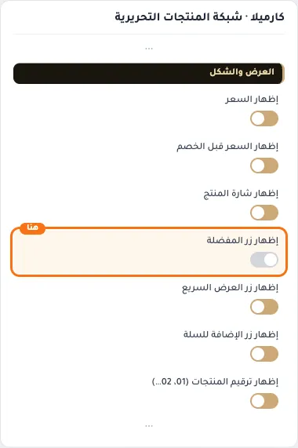

## «إظهار زر العرض السريع»
مفتاح · الافتراضي: مفعّل

**الوظيفة:** يظهر زر العرض السريع لرؤية المنتج دون مغادرة الصفحة.

- **بعد قلب المفتاح**
  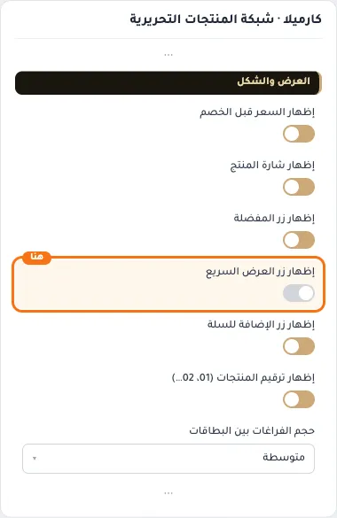

## «إظهار زر الإضافة للسلة»
مفتاح · الافتراضي: مفعّل

**الوظيفة:** يظهر زر الإضافة للسلة على البطاقة.

- **بعد قلب المفتاح**
  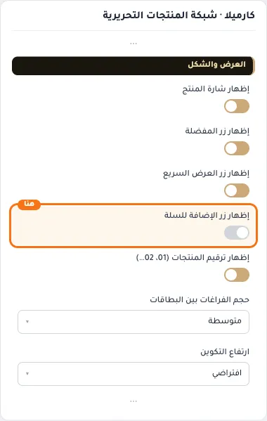

## «إظهار ترقيم المنتجات (01، 02…)»
مفتاح · الافتراضي: مفعّل

**الوظيفة:** يرقّم المنتجات (01، 02…) بجانب كل بطاقة.

- **بعد قلب المفتاح**
  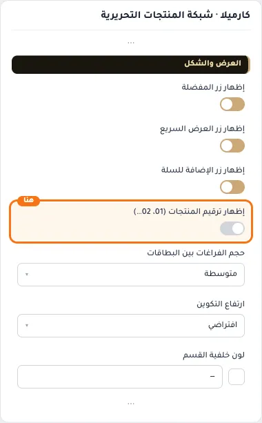

## «حجم الفراغات بين البطاقات»
قائمة منسدلة · الافتراضي: متوسطة

**الوظيفة:** المسافة بين البطاقات.

- **ضيقة**
  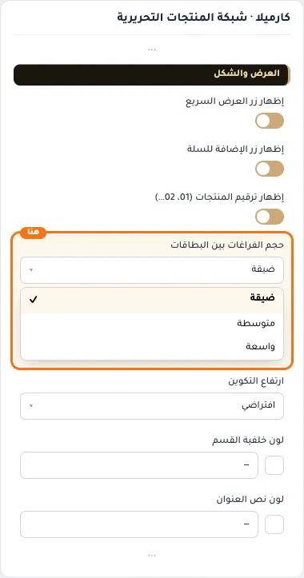
- **متوسطة** — القيمة الافتراضية.
  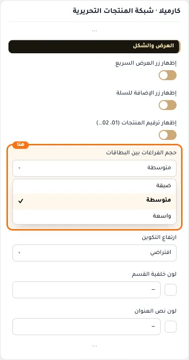
  
- **واسعة**
  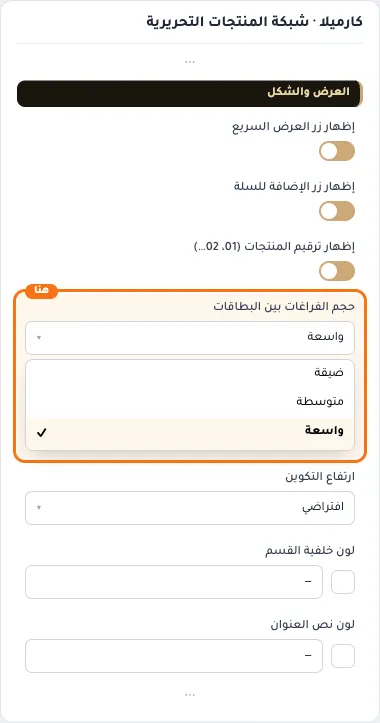

## «ارتفاع التكوين»
قائمة منسدلة · الافتراضي: افتراضي

**الوظيفة:** على سطح المكتب؛ على الجوال يتناسب مع عرض الشاشة.

- **منخفض**
  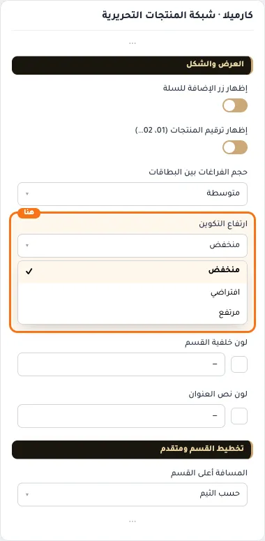
- **افتراضي** — القيمة الافتراضية.
  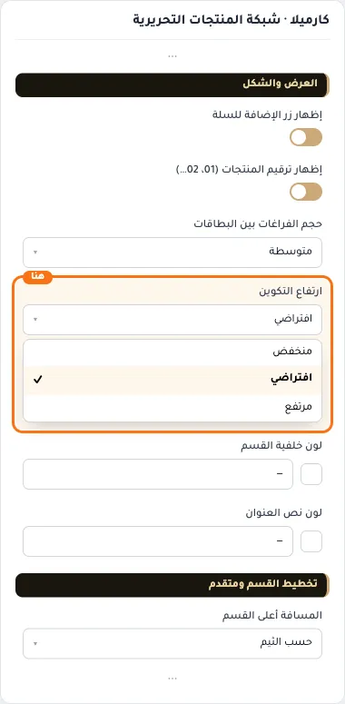
  
- **مرتفع**
  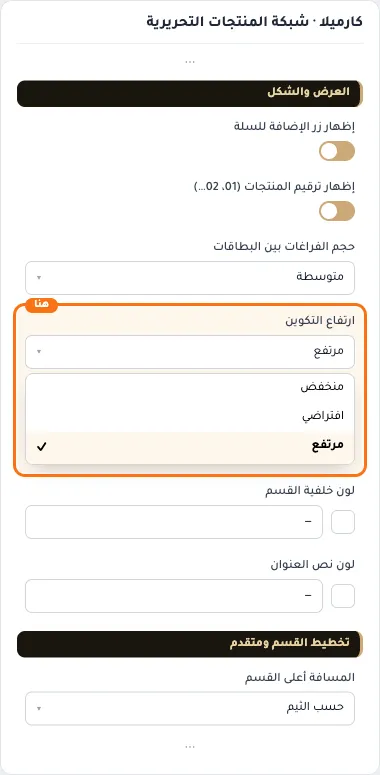

## «لون خلفية القسم»
لون · الافتراضي: فارغ

**الوظيفة:** اتركه فارغًا للّون الافتراضي.

- **لون خلفية القسم**
  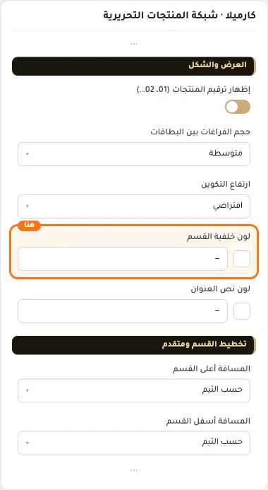

## «لون نص العنوان»
لون · الافتراضي: فارغ

**الوظيفة:** اتركه فارغًا للّون الافتراضي.

- **لون نص العنوان**
  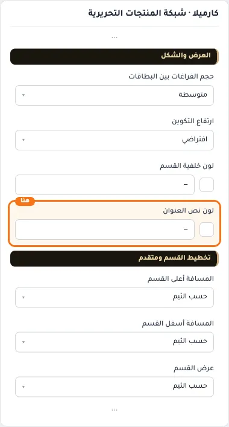

## «كلاس CSS مخصص»
نص · الافتراضي: فارغ

**الوظيفة:** للمصممين. كلاس القسم الثابت: cml-s--cml-editorial-masonry

- **كلاس CSS مخصص**
  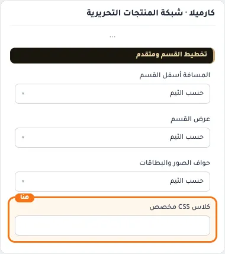
